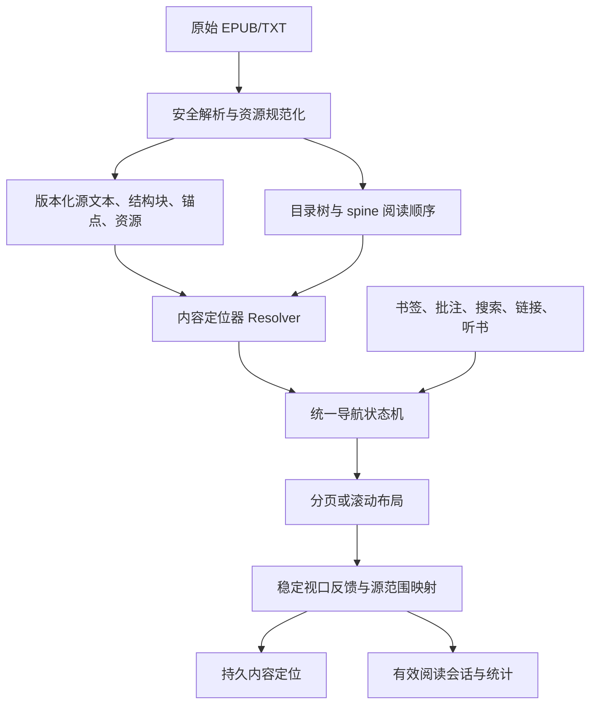

# FlowReader 内容定位、EPUB 结构与阅读统计改造实施计划

版本：1.0。编制日期：2026-09-10。用途：交给另一名 AI 或开发者逐阶段执行。

**本文件是实施规范，不是已完工报告。当前仅创建计划书，没有实施本计划中的源码、数据库或依赖修改。**

## 0. 执行契约：先读这一节

### 0.1 目标及优先级

本次必须交付以下六项相互接通的能力，不接受只有模型、没有真实阅读界面的实现：

| 需求 ID | 必须交付的用户行为 | 优先级 |
|---|---|---|
| R1 | 改字号、换字体、旋转、切换阅读模式、关闭重开后，仍定位同一处内容；书签、批注、搜索与听书共享内容坐标 | P0 |
| R2 | EPUB 导入保留正文结构和来源，不再不可逆地压成纯文本；支持基础语义排版 | P0 |
| R3 | 全书进度按实际文本量计算；阅读时间与翻页次数脱钩；剩余时间采用一致单位与有效样本 | P0 |
| R4 | 目录按卷和子章节组织，卷范围清楚，可独立展开/收起；卷标题不再成为无意义的正常阅读章节 | P0 |
| R5 | EPUB 插图在分页和滚动模式都显示；资源缺失、格式不支持、解码失败都可诊断，不静默消失 | P0 |
| R6 | EPUB 同文档/跨文档锚点、章节链接、脚注与返回原处可用，且不会触发额外翻页 | P0 |

同时保住上一轮修复的四个约束：单手势至多一次导航；跨章正反向对称；旧章节异步回调不能覆盖新状态；正文不得侵入页眉页脚。

### 0.2 范围边界

1. 本期完整支持：TXT、可重排 EPUB 2/3 的内容定位；EPUB 基础段落、标题、强调、链接、脚注、图片、列表、引用、基础表格、注音的语义保留及下文指定呈现。
2. PDF、漫画保留各自固定页面定位模型，不得把它们的页码伪装成字符位置。FB2、MOBI、Markdown 通过现有正文投影适配器保持可读，不能因本次修改退化；不要求本期重写它们的格式解析器。
3. 不做全量浏览器 CSS 引擎、脚本运行、DRM 解密、云同步、音频媒体叠加、任意数学排版、竖排和双页跨页仿真。保留这些原始资源及能力诊断，不宣称完整 EPUB 标准一致性。
4. EPUB 固定版式必须识别并提示“统一排版兼容显示”；不承诺出版物原版式。不得静默把它当正常可重排书后声称完美支持。
5. 保持现有 Compose 原生排版路线，不引入 WebView。不因已经声明 Readium 依赖就假定应用实际使用了 Readium 导航器。
6. 持久化模型、旧书修复、备份还原、统计 UI 联动属于本期必做；跨设备传输服务本期不做。

### 0.3 允许和禁止

- 执行前必须取得实施任务授权。用户只让“生成计划书”时不得改源码。
- 用户全局规则要求：**实际数据库 schema 迁移、新重大依赖、安全策略变更，实施前需要确认。** 先完成代码审计、纯函数设计和测试夹具；提交本计划指定的具体变更说明后再请求一次必要确认。已获覆盖授权的操作不重复询问。
- 不得删除旧数据库、清空书架、要求用户删书重导、使用 destructive migration、覆盖原始 EPUB/TXT、重置书签/批注或以清缓存掩盖兼容问题。
- 不得用固定延时修复翻页竞态，不得将同一旧整数直接写入新字符字段，不得按文件名猜图，不得仅修新导入路径。
- 不得一边保留旧混合位置写入，一边新增内容定位写入，形成两个事实源。
- 允许少量兼容适配器；每个适配器必须注明输入单位、输出单位、退出条件和覆盖测试。
- 保护工作区已有改动。禁止 `git reset --hard`、`git checkout --`，禁止无关格式化、依赖升级及整体重写。
- 每阶段必须给出真实修改 diff、运行命令、退出码、用例结果、未验证项。不能用测试数量或覆盖率代替实际功能验收。
- 本计划中的数字门槛是本项目验收约定，不是 EPUB 标准要求；实现不能私自放宽。确需变更，记录原因、影响和新验收值。

## 1. 基线、事实与问题原因

### 1.1 基线定位

- 仓库：`C:/Users/lenovo/.dsh/agy-link/media/flowreader`。
- 本次核对的 HEAD：`077ea56d63070d2b93caa58eb06ca03c5ffa55c3`；**工作区存在大量未提交改动，因此 HEAD 不是全部代码快照**。执行者必须先记录当前 diff 和未跟踪文件清单。
- 实际 Room 数据库是 v9，定义在 `data/src/main/java/com/flowreader/app/data/local/AppDatabase.kt`，schema 位于 `data/schemas/com.flowreader.app.data.local.AppDatabase/9.json`。
- 两份 `FLOWREADER_MASTER_SPECIFICATION.md` 当前 SHA-256 相同：`8A43BEB81030E740571D194377D7DFB30DC0AC88EA459995F7F1C34A43A393D1`。仓库文档和 Antigravity 文档均为参考，不把其中“全功能稳定可用”当作本次验收证据。
- 依赖声明中已有 Coil 2.7.0、Jsoup 1.18.3、Readium Kotlin Toolkit 3.1.2。本计划不要求升级；使用具体 API 前核对当前依赖实际可用接口。
- 旧修复 APK、测试报告属于历史产物，不能拿来证明本次尚未实施的内容引擎改造。

### 1.2 已核实缺陷

| ID | 位置/事实 | 为什么需要改 |
|---|---|---|
| F01 | `Book.currentPosition` 是 Int；滚动回调上报像素，分页回调上报页码；`ReaderPositionUnit` 中字符分支仍以像素近似 | 没有可靠内容坐标，重排、统计、听书不能共同解释 |
| F02 | `ReaderProgressEngine.remainingMinutes()` 用 `chapter.content.length - currentPosition`，未加载正文的 metadata 可能为空 | 单位不一致，剩余内容量也不完整 |
| F03 | `ReadingProgress.fraction()` 按章节等权；`chapterAt()` 也按章节数逆推 | 长短章进度失真，进度条拖动与实际内容量不一致 |
| F04 | `ReaderSessionTracker` 使用墙上时钟、像素差/估算页字数计算速度；`saveReadingStats` 有 `seconds > 0 && pages > 0` 条件 | 不翻页阅读的时间丢失，跳转与快速翻页污染速度 |
| F05 | `BookParser` 的 EPUB nav/NCX 把 href 去掉 `#fragment` 后存入 Map | 同一 XHTML 多个目录项互相覆盖，无法文内精确跳转 |
| F06 | nav 读取后代列表并扁平化，分组依赖直接 `<a>` | 丢失层级及 `<span>` 卷头；不能正确表达卷范围 |
| F07 | `ReaderTocSheet.TocVolumeRow` 只有展开图标，没有折叠操作和状态；卷 key 使用标题 | 同名卷冲突；看似可点却不能收起 |
| F08 | `appendChunkedChapter(..., volume)` 接收卷字段，但创建 `Chapter` 时没有传入 `volume` | 分卷信息可能在组装章节时丢失；不能只改目录 UI |
| F09 | `htmlToFormattedText` 把粗体、斜体、链接、列表等转成文本或简单标记 | 语义和链接目标在导入阶段不可逆丢失 |
| F10 | 图片依赖 `[IMG:absolutePath]` 字符串；图文混排不保证独立段落；资源 path 处理不统一 | 解析成功的图片也可能无法被渲染分支识别 |
| F11 | `resolveImagePath` 使用表单式 URLDecoder，并以 basename 兜底匹配 | `+`、相对路径、同名图片等可能错配或漏图 |
| F12 | `PagedReader` 自行测图片高度；`ReaderImage` 的实际 padding/约束不是统一测量结果 | 分页预留高度与真实绘制有不一致风险，必须统一 |
| F13 | 大章拆成多个持久章节，标题增加 `(N)`；trim/标题去重/简繁展示各处独立执行 | 物理分片污染目录；显示索引与源文本索引易偏移 |
| F14 | 书签使用阅读器位置；批注使用字符范围；`ReaderTextMapping.rawRange` 为闭区间而持久批注结束位置为开区间 | 各入口定位约定不同，必须统一，且不能退回已有少一个字符的旧错误 |

### 1.3 必须保持审慎的结论

1. TXT 新导入已经有“识别卷标题而不生成普通章节”的尝试。不能写成“所有卷都被错误生成章节”。须分别复现旧书、括号卷标题、分卷字段丢失、EPUB 卷扉页、卷前正文等情况。
2. 未取得用户问题 EPUB 的样书并在设备上重现，不能断言该书的插图失效只由某一条路径造成。F10—F12 是确认的代码问题/风险，实际样书还可能包含 SVG、损坏资源、非标准 href 或固定版式。
3. 旧页码/像素值缺失历史屏幕、字体和排版参数时，不能保证无损转换。本计划必须把“精确”“近似”“未定位”分别保存。
4. 以下设计使用“规范源文本偏移”，它不是 EPUB 压缩包的字节偏移，也不是 XHTML 字符串中含标签的原始字符偏移。原始资源另外保留，二者不得混称。

## 2. 最终架构与不可破坏的不变量

### 2.1 五层对象必须分离

| 对象 | 定义 | 不允许做的事情 |
|---|---|---|
| Publication | 用户的一本书，具有稳定 UUID、原始文件、内容修订版本 | 不以书名或文件路径当永久身份 |
| SourceDocument | 一个 EPUB 内容文档，或 TXT 的虚拟文档；有稳定源坐标 | 不以一页或数据库自增章 ID 代替文档 |
| ReadingSection | 正常阅读顺序中的逻辑段/章，包含一个或多个源文档范围 | 不为性能拆片生成 `(1)(2)` 目录章节 |
| TocNode | 出版物目录树节点，可是卷、章节、附属入口，目标可以为空 | 不让卷折叠决定正文是否可读，不让 TOC 顺序重排 spine |
| LayoutPage/Viewport | 当前字体、屏幕和模式下的临时排版结果 | 不作跨布局、跨设备的持久定位依据 |

### 2.2 数据流



### 2.3 强制不变量

- INV01：书籍当前位置只有一个权威内容定位；页码/像素只能在 `LayoutState` 或有完整 layoutKey 的临时缓存中存在。
- INV02：同一原始文件、同一规范化版本重复解析，文档 key、源文本、块 ID、锚点和目录 ID 必须确定性一致。
- INV03：源范围为 UTF-16 边界 `[start, endExclusive)`；跨文档范围由一组有序源范围表达。
- INV04：字符索引不得落在代理对中间；交互选择、断页优先落在字素簇边界；不得拆开表情组合序列。
- INV05：显示转换不能修改规范源文本；隐藏标题、缩进、强调、简繁变换都有显式映射。
- INV06：阅读順序来自阅读 manifest；卷折叠、搜索过滤、目录重复节点均不能修改它。
- INV07：一次触摸序列至多提交一个 NavigationIntent；动画中的重复回调不能成为新意图。
- INV08：只有当前 publication/revision/navigationGeneration/layoutGeneration 的反馈可以提交当前位置。
- INV09：导入新 revision 成功前，旧 revision 和旧用户数据始终可用。
- INV10：未解析到的资源/锚点必须返回有类型的错误，不允许静默丢弃或随机替代。
- INV11：进度的分母来自完整出版物索引；不能依赖当前已加载章节集合。
- INV12：阅读时间不依赖翻页次数；导航距离不等于阅读量；弹层、后台、锁屏不累计前台正文阅读时间。

## 3. 强类型定位模型与精度规则

### 3.1 建议在 domain 新增的合同

以下为接口规格，不是声称已经存在的可编译源码。按当前序列化库实现，不为序列化单独引入重大依赖。

```kotlin
data class TextLocator(
    val version: Int = 1,
    val publicationId: String,
    val revision: String,
    val normalizationVersion: Int,
    val sectionId: String?,
    val documentKey: String,
    val offsetUtf16: Int,
    val affinity: Affinity,
    val blockId: String?,
    val elementId: String?,
    val context: TextContext,
)

data class TextContext(val before: String, val after: String)
enum class Affinity { BEFORE, AFTER }
enum class ResolutionQuality { EXACT, CONTEXT_MATCH, APPROXIMATE, UNRESOLVED }

data class SourceRange(
    val documentKey: String,
    val startUtf16: Int,
    val endUtf16Exclusive: Int,
)

data class LocatorResolution(
    val locator: TextLocator?,
    val quality: ResolutionQuality,
    val reasonCode: String?,
)
```

还须定义 `ContentLocator` 的带类型联合：`Text(TextLocator)`、`FixedPage(publicationId, revision, pageId, pageOrdinal, verticalFraction)`。PDF/漫画只走后者，正文统计与固定页统计分离。

字段规则：

| 字段 | 严格语义 |
|---|---|
| publicationId | 首次入库生成 UUID；移动文件/重解析不改；备份导入保留并做冲突检查；SQLite bookId 仅本地关联 |
| revision | 原始文件 SHA-256 与规范化版本、parserSchemaVersion 组成的确定性摘要；资源或规范源文本改变必须变更 |
| documentKey | EPUB 解引用后、相对于容器根目录的规范路径，大小写敏感，不含 query/fragment；TXT 固定 `text/main` |
| sectionId | 逻辑章节稳定 ID，作为提示和目录选中依据；定位以 documentKey + offset 为准 |
| offsetUtf16 | 该文档完整规范源文本的 UTF-16 边界，范围 `0..textLengthUtf16`；不可存页码、像素、codePoint 数 |
| affinity | 边界落在两个块/页之间时归属前侧或后侧；默认 AFTER；文档末尾使用 BEFORE |
| blockId | 结构块稳定身份，辅助图片/空块定位和重排恢复，不等同于布局 fragment ID |
| elementId | EPUB 原始 id/xml:id 或兼容 a[name] 的已解码值；不存在则 null |
| context | 原始规范源文本位置之前、之后各最多 32 个 Unicode code point；不跨文档；不得截代理对 |

`sectionId` 生成：EPUB 优先 `SHA256(documentKey + sourceAnchorIdentity)`；同一目标多次目录引用不生成多个 section；无锚点使用文档起点或规范结构块身份。TXT 使用卷出现路径、标题出现序号和正文前缀指纹生成；这是同一 revision 内稳定规则，修订后的稳定性依赖 locator resolver，不能承诺标题重复时绝对不变。

### 3.2 规范源文本 v1

执行顺序必须固定，并为每一步有 golden：

1. 保留原始文件和 EPUB 条目字节；按 XML 声明/BOM 及格式要求解码，失败报告具体文档，不静默换编码。
2. 文本节点解码实体。普通 XHTML 文本中的连续 HTML 可折叠空白归一为一个 U+0020；`pre`/预格式块保留空白。CRLF/CR 统一 LF。NBSP 不当作普通可折叠空格。
3. 保留非空白可见文字顺序、标点、大小写和 Unicode 字形，不执行 NFC/NFKC，不做简繁转换，不删“重复标题”。
4. 一个独立文本叶块结束后追加一个 LF；最后一个叶块也追加 LF；List/Quote/Figure 等容器不额外追加分隔符，避免父子各加一次。空文本块不自动生成多个空行。`br` 在块内生成 LF。列表项文字参与文本，自动编号/圆点不参与；表格单元格间 TAB、行末 LF，表格内文本节点不再另加段尾 LF，显式多段内容以单元格内 LF 保留。
5. 图片/不含文本的可见原子对象在源流中占一个 U+FFFC；alt 保存在资源/节点元数据，不混入正文字符计数。整个内联图片前后文本必须有明确源范围。
6. `ruby` 的正文基字写入主文本，`rt/rp` 存入注音语义；TTS/统计默认不重复计算注音。
7. 脚注文字保留源坐标及 `AUXILIARY` role，不因不进入主阅读统计就从文本中删除。脚注引用的可见标记保留源坐标，但不计正文权重。
8. 不绘制的脚本/样式等不进入文本流；保留原资源，不执行。CSS 不参与 v1 源文本生成，避免换主题导致内容坐标变化。
9. 每个文本片段、块、HTML 元素 ID 都记录对应规范源范围；保留 DOM 来源路径以供诊断。原始 XHTML 字节位置无需伪造为文本位置。
10. TXT 解码后统一换行；已有清理规则若会删正文，必须先形成版本化规范源，再作为可追踪的显示过滤执行，或通过显式重解析产生新 normalizationVersion。禁止运行时改写坐标基准。

统计使用 Unicode code point 数，去掉空白、U+FFFC、辅助 role 和生成分隔符；它与 UTF-16 定位长度不同。v1“字数”即非空白 code point 数，中文/英文标点也计 1；UI 在统计说明中明确，不宣称语言学词数。

### 3.3 显示映射

用 `DisplayMapping` 替代“字符数肯定 1:1”的假设：

- 显示边界数组长度必须 `displayText.length + 1`，每个边界映射到源边界或 synthetic 标记。
- 一个显示范围可以对应多个源范围；例如非等长简繁转换、ruby、表格及跨块选择，不得只存一个整数。
- 人工缩进、列表圆点、重复的装饰性页眉标题为 synthetic；点击这些位置定位到最近真实正文边界；复制/批注不得写入这些人工字符。
- 简繁转换若当前实现保证等长，也必须测试并在适配层检查；不等长输入不得继续用旧的直接索引法。
- 隐藏正文标题回声，只隐藏显示节点，保留源区间；目标在隐藏区间时解析到下一可见块并保留原 locator，返回 `EXACT` 与 `HIDDEN_TARGET_ADJUSTED` 展示原因，而不是改写源数据。
- 分页片段携带 `sourceRanges`，渲染和测量使用同一个 AnnotatedString/样式规格，禁止一边测纯文本一边渲染不同长度富文本。
- 同一 source locator 经过 `source → display → source` 回环，真实文字必须完全一致；synthetic/隐藏区域允许合同规定的最近边界归并。

### 3.4 解析与修订恢复优先级

`resolve(locator, activeRevision)` 按以下顺序停止，不可随机跳过：

1. publicationId 匹配、revision 相同、documentKey 与范围有效：EXACT。
2. revision 不同但相同 documentKey + 唯一 elementId 存在：在该元素内核对 context 和相对偏移；匹配成功为 CONTEXT_MATCH，不匹配进入下一步。
3. 同文档原偏移前后 4096 UTF-16 范围查完整 `before + after` 边界；仅唯一候选可接受。再扩大到同文档，仍唯一才接受。
4. 文档重命名：查保存的文档内容指纹映射；不能仅凭 basename。随后只在对应逻辑 section 的候选文档中搜索 context。多候选判为歧义。
5. 无精确匹配但原 section 可辨认：定位该 section 开头，质量 APPROXIMATE，保留原 locator 和 reason；批注不得自动贴到这个近似范围。
6. 连 section 都不能确定：UNRESOLVED；展示原书签/批注文字与“定位待恢复”，允许用户手动找位置。当前位置可明确提示后从第一正文开始，但不得覆盖未解析的原记录。

不做模糊相似度自动迁移，不按“第几个重名章节”冒充精确匹配。CFI 本期不实现完整生成/解析；可把原 CFI 作为可选扩展保留，不能宣称自定义 JSON 就是 EPUB CFI。

## 4. EPUB 解析、结构正文与资源合同

### 4.1 解析流水线与输出

`BookParser.parseEpub` 改为协调器，依次调用以下独立可测组件：

1. `EpubContainerReader`：验证容器、条目名、大小限制；读取 container.xml 和 rootfile。
2. `EpubPackageParser`：namespace-aware 读取 OPF metadata/manifest/spine；支持 EPUB 2 和 3；记录 manifest properties、media-type、fallback、spine linear、page-progression-direction、rendition 属性。
3. `EpubResourceResolver`：统一 href/path/fragment 解引用。
4. `EpubNavigationParser`：EPUB3 toc nav 优先、EPUB2 NCX 回退、最后按 spine/标题生成目录。
5. `EpubDocumentParser`：将各可读文档解析为 `StructuredDocument`、规范源文本、source map、anchor map；保留源资源。
6. `ReadingManifestBuilder`：生成主阅读序列、辅助内容、逻辑 sections、目录目标映射及统计索引。
7. `PublicationStore`：验证所有内部引用后，提交版本化内容包和数据库元数据。

输出 `ParsedPublication` 至少包含 publication metadata、原文件哈希、规范化版本、documents、sections、tocTree、resources、diagnostics、统计总量。任何步骤失败返回具体 stage/document/resource，不返回表面成功的空书。

### 4.2 路径与链接解析算法

统一接口：`resolve(baseDocumentKey, rawHref): ResourceTarget`。只允许这一处实现路径逻辑。

1. 先拆 scheme、authority、path、query、fragment，再按组件解码。**禁止使用会将 `+` 变空格的表单 URLDecoder 直接解码整个 URL。**
2. 相对路径以引用它的文档目录为基准；OPF manifest href 以 OPF 为基准；nav/NCX 的 content src 以对应 nav/NCX 文件为基准；XHTML img/a 以该 XHTML 为基准。有效的本地 `xml:base` 逐层处理，不能突破容器；HTML base 若支持也必须走同一规则且给诊断，不允许暗中启用外网。
3. 路径先分段，各段 percent-decode 一次 UTF-8；保留 `+`、大小写和 Unicode；非法百分号/非法 UTF-8 返回 INVALID_URI。拒绝解码后段内 `/`、`\`、NUL，禁止二次解码。ZIP 条目名本身是文件名，不做 URL 解码。
4. 解码后处理 `.`/`..`，上溢容器根返回 PATH_ESCAPE；绝对设备路径、UNC、驱动器路径不允许。容器根相对 `/path` 可映射到容器根，必须与宿主绝对路径彻底隔离。
5. query 从资源身份中分离且保留原值；包内静态资源检索不使用 query，不把 `?x` 当文件名。fragment 单独 percent-decode 一次，不删、不 lowercase；`#` 是文档起点，只有 `#id` 是元素目标。
6. 资源键使用与 ZIP 条目完全一致的规范容器路径，区分大小写。禁止 basename 兜底、全局大小写不敏感匹配、把 `_` 替代目录名。
7. URI 路径规范化发生碰撞、ZIP 重复条目、重复 manifest ID 时返回结构错误并停止激活新 revision；不能 firstOrNull 静默任选。
8. 识别 `https/http/mailto` 为外部目标，只在用户主动点击并确认目标后交系统处理；自动阅读/图片加载不触网。`javascript/file/content/intent` 不作为 EPUB 链接执行。安全策略实际变更遵守 0.3 的确认要求。
9. 对未支持的 data URI、SVG fragment、媒体 fragment 等保留原引用并返回明确能力错误。本期 data URI 的 PNG/JPEG/WebP 可实现受同等大小限制的本地解码；未实现必须作为能力限制列入报告，不得静默吞图。

强制例子：`Text/a.xhtml` + `../Images/a+b.png` → `Images/a+b.png`；`../Images/a%20b.png` → `Images/a b.png`；`#n1` → 同文档 id `n1`；`b.xhtml#%E6%B3%A81` → id `注1`；`../../../x` → PATH_ESCAPE；`%252e%252e` 解码一次后是字面 `%2e%2e`，不能再当 `..`。

### 4.3 目录树与阅读顺序

- EPUB3：只把 token 列表包含 `toc` 的 `epub:type` nav 当主目录；`landmarks/page-list` 独立保存，不混入章节。多个 toc 返回可诊断格式错误，不随机拼接。
- 每个 `li` 读取直接子 `a` 或 `span`，再递归直接子 `ol`；不能用一次后代选择器替代树递归。span 是有效分组标题；无链接不代表应丢弃。
- EPUB2：NCX 的 navPoint 递归解析；label 只读当前节点直接 navLabel，不把子节点文本拼进父标题；保留 content src fragment。
- `TocNode` 包含 `id,parentId,order,label,kind,target,children`；kind 为 GROUP/ENTRY；卷是带 VOLUME role 的 GROUP，允许 GROUP 同时具有 target。
- nodeId：源 nav/NCX 路径 + 稳定节点路径/id 的哈希；同名不同位置必须不同 ID。UI key 不能用 label。
- 主阅读顺序只按 spine 的 linear yes/省略项构建；linear no 为辅助访问入口。该选择是本产品策略，标准允许阅读系统不同呈现，不能误写成标准强制隐藏。
- 同一 XHTML 中多个不同锚点作为不同目录目标保留；同目标别名节点也保留，不能覆盖。
- 逻辑 section 的边界取主 spine 上不同的叶级可读目录目标，并按实际源顺序排序；同一边界多个标题以第一合法主目录标签为 canonical title，其余为别名。第一目标之前的真实正文生成“前言/正文起始”section。
- 一个 section 可跨多个相邻 spine 文档：从其目标到下一个逻辑目标之前全部纳入；一个文档也可包含多个 section。无目录时每个 spine 文档是缺省 section；不得凭性能分片创造章节。
- 嵌套目录父目标和子目标在同一边界时不重复生成 section；父目标之前存在真实引言正文时，独立保留引言 section。TOC 原顺序仍保留并诊断与 spine 不一致，不能按 TOC 重排正文。
- GROUP 的覆盖集合来自所有可读后代目标所属 section 去重；连续集合可显示首尾范围，非连续集合显示“共 N 节 · 非连续”，不得假装覆盖夹在中间但不属于该卷的章。

### 4.4 卷标题、卷序与旧伪章节判定

只有同时符合下列全部条件的节点才可标为 `STRUCTURAL_TITLE` 并从正常翻页序列排除：

1. 被结构明确识别为卷/分组，不是仅包含“卷”字的普通标题。
2. 正文在空白归一后只有该卷标题，或只有与该标题完全相同的标题节点。
3. 不含图片、注释、链接、额外段落、诗句、作者说明或其他有意义内容。

原始内容和锚点仍保留；原链接跳到这个卷标题时，正常阅读导航重定向该卷第一个真实正文 section，并给出结构重定向结果；打开原始辅助内容仍可查看标题页。无法判定时保留为可读“卷扉页”，不要误删。

TXT 规则：识别第X卷、卷X、分卷X及括号包裹形式；标题检测函数返回独立的 HeadingKind，不允许某个分支漏设 isVolume；同名卷按出现位置区分。卷标题后、第一章前的非空正文生成“卷序”，属于该卷且参与阅读/统计。修复 `appendChunkedChapter` 丢 volume，但最终结构不再依赖这个字符串分组。

### 4.5 结构化正文合同

`StructuredDocument` 保存：`documentKey, sourceText metadata, blocks, anchorIndex, resourceRefs, diagnostics, schemaVersion`。

块类型和本期渲染必须如下：

| 类型 | 必须保留 | 本期呈现 |
|---|---|---|
| Paragraph/Heading | 源范围、标题 level 1..6、inline spans | 用户字体和主题下的原生文字，层级样式有差异 |
| InlineSpan | strong/em/code、link、noteref、原始属性的受控子集 | 粗/斜体、等宽代码、可命中的链接，允许嵌套样式 |
| Image/Figure | resourceId、alt、caption、源位置、尺寸、原始引用 | 正文内图片/图注，点击预览 |
| List/ListItem | ordered、start、value、嵌套层级、子块 | 有序/无序列表；续页不重置编号，不强加中文首行缩进 |
| Quote | 引用层级和子块 | 缩进/边线，不把引用当普通段落 |
| Table | 行列、th/td、rowspan/colspan、单元格子内容 | 基础表格可单独打开横向查看；正文给真实表格预览，不能扁平无标签拼字 |
| Ruby | 基字范围、注音内容 | 原生可用时上方注音；否则明确的“基字（注音）”兼容显示，主坐标仍是基字 |
| Preformatted | 换行和空白 | 保留空白，可横向查看；分页不能字符截断后丢行 |
| Footnote/Aside | role、id、backlink、子块 | 作为辅助正文或脚注弹层，提供回原文 |
| Unsupported | 原标签、源资源引用、替代文字 | 显式兼容占位，可查看可用替代内容，诊断说明 |

基础表格即含普通文本/图片的单元格，需保存跨行跨列并在专用查看器正确表达；复杂嵌套表格允许降级为带行列标题的逐单元格查看，不允许数据丢失。SVG/MathML 不得把“保留源资源”说成“已正确渲染”。

### 4.6 图片是结构对象，不是文本标记

1. 新 EPUB 不再生成 `[IMG:...]`。旧标记仅由 LegacyDocumentAdapter 读取，必须校验路径属于该书资源目录。
2. 资源落盘使用 `resourceId = SHA256(containerPath + contentHash)`，文件名使用摘要，不使用书名、timestamp 或 basename。DOM/locator 内不存设备绝对路径。
3. 图片 metadata 包含 mediaType、byteSize、intrinsicWidth/Height、orientation、contentHash、decodeStatus。PNG/JPEG/WebP 必须支持；GIF 至少显示首帧并标明静态；SVG 包装图片和普通本地静态 SVG 要纳入专门验证。
4. 先对已有依赖做 SVG 能力 spike；若需要 `coil-svg` 等新依赖，报告具体 artifact/版本兼容、许可证、网络行为及 APK 成本，取得必要确认后接入。**PNG/JPEG 通过不代表完成常见 EPUB SVG 插图支持。** 未获授权时该子项标 BLOCKED，不得装作 R5 全部通过。
5. `svg image` 的 href/xlink:href 按 SVG 所在文档解析；独立 SVG 也经过资源封装。不可只处理 ``。静态 SVG 中脚本、外部资源不得执行/自动下载。
6. 本期不把整本 EPUB 的图片预解码。先读尺寸，使用按目标视口采样解码；解码结果缓存受字节预算控制。大图预览可以按需二次采样。
7. 同一 `ImageLayoutSpec(widthPx,heightPx,paddingPx,captionMetrics,resourceId,layoutKey)` 同时用于分页占位和 Composable 约束；纵横比适配并 `ContentScale.Fit`。单页图正文框不超过可用高度；图片内部不得再偷偷加未计入的 padding。
8. 尺寸已知时在解码前固定布局；未知/坏图保留固定 120dp 内容占位并纳入共同测量。后来获得正确尺寸时只触发一次版本化重排，恢复当前源锚点，不能把用户推到别处。
9. 资源不存在、受限、解码失败分别显示可理解占位和 alt；诊断记录原 href 和解析结果。存在文件但 Coil 解码失败也必须有 error UI。
10. 预览支持关闭/返回、缩放、alt/图注；预览手势由预览层消费，不能传给正文翻页。关闭恢复当前定位，不产生导航进度或已读文字。

## 5. 内容包、数据库与旧数据迁移

### 5.1 持久化取舍固定

采用 **Room 保存索引和用户状态，内部文件保存版本化结构正文及资源**。不把整本结构 JSON 或 Bitmap 塞进一条 books 记录。正文文件不放可被系统随时清理的 cache 目录。

目标内部路径：`files/books/<publicationId>/revisions/<revision>/`。其中 `source/` 保存原始输入或可验证的持久来源副本，`documents/` 保存规范内容块，`resources/` 保存可渲染资源，`manifest.json` 保存全部索引摘要和校验和。绝对路径由 Repository 在本机解析，不写入 locator/备份跨机字段。

文档按目标 32,768 UTF-16 文本单位生成结构分片；分片只为 I/O 和布局，不是章节。优先块边界，超长段落使用保留同一 blockId 的连续片段并记录 start/end；避免代理对/字素簇中断。表格优先按行分片，单行超过目标则按单元格文本分片并保留 row/cell ID、continuation 标记；图像只存引用。若一个完整字素簇本身超过目标，不截断它，允许单个分片超出并受原文档总大小上限保护。分片有 checksum、起止源偏移、顺序与 schemaVersion；文档 manifest 存分片索引、锚点索引、每块统计及主/辅助 role。读取只加载目标和邻近窗口。

### 5.2 v9 → v10 schema 合同

版本 10 是基于当前 v9 的实施目标。若执行时版本已变，重新核对后使用下一合法版本，不覆盖任何现存迁移。本节为待确认的具体 schema 设计。

现有表采用 additive migration，旧列本期保留：

| 表 | 新字段（SQL 类型、空值/默认） | 规则 |
|---|---|---|
| books | `publicationId TEXT NULL`、`activeRevision TEXT NULL`、`contentState TEXT NOT NULL DEFAULT 'LEGACY'` | migration 内对每条旧书生成 UUID 回填，再创建 publicationId 唯一索引；实体仍允许 legacy null 以兼容中断恢复 |
| bookmarks | `locatorJson TEXT NULL`、`locatorQuality TEXT NOT NULL DEFAULT 'UNRESOLVED'`、`legacyUnit TEXT NOT NULL DEFAULT 'UNKNOWN'` | 保留 chapterIndex/position/text，不覆写旧单位 |
| annotations | `rangeLocatorJson TEXT NULL`、`locatorQuality TEXT NOT NULL DEFAULT 'UNRESOLVED'` | 保留全部旧 range/text/note/color/时间；旧批注字符位置有明确单位，仍需源版本转换 |
| reading_stats | `visualReadMillis INTEGER NOT NULL DEFAULT 0`、`ttsReadMillis INTEGER NOT NULL DEFAULT 0`、`qualifiedTextUnits INTEGER NOT NULL DEFAULT 0`、`settledTurns INTEGER NOT NULL DEFAULT 0`、`statsVersion INTEGER NOT NULL DEFAULT 1` | 历史 readTimeSeconds/readPages 不覆写为精确新统计；历史和 v2 字段分开展示/聚合 |

新增表，字段不得省略；通用约束为所有 JSON UTF-8、枚举使用稳定字符串、计数非负、时间毫秒 Long。所有子表 bookId 外键指向 books 并 ON DELETE CASCADE：

| 表 | 字段与键 | 用途 |
|---|---|---|
| publication_revisions | PK `(bookId,revision)`；`normalizationVersion INTEGER,parserSchemaVersion INTEGER,sourceHash TEXT,manifestRelativePath TEXT,state TEXT,totalMainTextUnits INTEGER,createdAtMillis INTEGER` | state 为 STAGED/READY/RETIRED/FAILED；total 使用 Long |
| publication_documents | PK `(bookId,revision,documentKey)`；`ordinal INTEGER,linear INTEGER,role TEXT,textLengthUtf16 INTEGER,mainTextUnits INTEGER,manifestRelativePath TEXT,sourceHash TEXT` | ordinal为该唯一文档首次出现在spine中的序号，未列spine为-1，不加唯一约束；linear表示至少一次属于主线；每次spine出现另存manifest的occurrenceId/ordinal/documentKey/linear，不覆盖 |
| reading_sections | PK `(bookId,revision,sectionId)`；`ordinal INTEGER UNIQUE within book/revision,title TEXT,kind TEXT,rangesJson TEXT,mainTextUnits INTEGER` | kind NORMAL/PREFACE/VOLUME_PREFACE；ranges 为按阅读顺序的源区间，不能重叠计量 |
| toc_nodes | PK `(bookId,revision,nodeId)`；`parentId TEXT NULL,siblingOrder INTEGER,label TEXT,kind TEXT,role TEXT,targetJson TEXT NULL` | 父关系在同 book/revision 内验证；防环；范围由 sections 映射推导 |
| reader_states | PK `bookId`；`locatorJson TEXT NULL,quality TEXT,legacySnapshotJson TEXT NULL,lastMainLocatorJson TEXT NULL,navigationSequence INTEGER,updatedAtMillis INTEGER` | lastMainLocator 用于浏览非主线脚注时保持主线进度；legacy 原值不可丢 |
| content_migration_jobs | PK `(bookId,targetRevision)`；`stage TEXT,errorCode TEXT NULL,attemptCount INTEGER,updatedAtMillis INTEGER` | 可恢复的逐书重解析任务，禁止开库时整库阻塞重解析 |
| reading_session_deltas | PK `deltaId TEXT`；`bookId INTEGER,sessionId TEXT,sequence INTEGER,localDate TEXT,zoneId TEXT,visualReadMillis INTEGER,ttsReadMillis INTEGER,qualifiedTextUnits INTEGER,settledTurns INTEGER,statsVersion INTEGER`；UNIQUE `(sessionId,sequence,localDate)` | 幂等增量与日聚合同事务提交，字段不为负 |

除表中明确标 NULL，新增表字段 NOT NULL；deltaId 使用 UUID，sessionId 使用 UUID。为所有 bookId 查询和 parent/ordinal 查询建立前缀索引；revision 关联建立复合外键或同事务强一致校验，不留指向非激活内容的悬空索引。Room entity、迁移 SQL、导出 schema 三者完全一致，测试验证，不用手写 JSON 冒充 Room 导出的 schema。

书目/目录万行查询只投影所需 metadata，不把 rangesJson/正文全读到列表。文档锚点与资源索引在内容包中，避免新增一张“每字符一行”数据库表。

### 5.3 原子导入与激活协议

文件系统和 Room 不能同一物理事务，因此使用 staged revision 协议：

1. 针对 bookId 获得导入互斥；计算原文件 hash；在同内部存储根下写临时 revision 目录。
2. 解析结构、资源、章节、目录和统计；校验 range、checksum、资源引用、循环目录和主线覆盖。
3. 完整写入 manifest，关闭文件并完成必要 flush；将临时目录原子重命名到不可变 revision 目录。已有相同 revision 时核对 checksum 后复用，不能覆盖活动文件。
4. Room 单事务写入 READY revision 元数据、全部文档/section/toc、用户定位的解析结果；最后切换 `books.activeRevision` 和 contentState=READY。
5. 提交后通知 reader 使旧布局缓存失效；FTS 在现有 `withIndexLock` 中针对该 revision 重建。搜索索引尚未完成时显示准备中，不能返回旧 revision 的错误位置。
6. 失败时数据库仍指向旧版；未引用的 staging/revision 标成可清理，不在失败路径删旧数据。
7. 程序重启时按 jobs/manifest/database 三方状态协调。若目录已完成但数据库未切换，可校验后续作；若 activeRevision 文件损坏，回到最后已验证的旧 revision 并报告错误。
8. 本期不自动删除迁移前的唯一可用 revision/原书；空间不足则暂停单书迁移，旧书继续可读。垃圾回收只能删除无引用 staging 和可重建缓存，重要原件遵守确认规则。

### 5.4 旧阅读位置迁移

迁移不能从当前全局 PageMode 反推所有历史记录单位。每条旧数据保存：`chapterIndex,position,format,unitEvidence,settingsSnapshotIfKnown,legacyContentHash`。

| 旧数据 | 转换路径 | 精度 |
|---|---|---|
| 明确的字符 offset，且保留旧正文 | 旧正文字符 → 旧源映射 → 新 source/context | 匹配一致才 EXACT/CONTEXT_MATCH |
| 有完整旧 layoutKey + 页面源范围 | 页码 → 对应源范围起点 | EXACT，明确这是旧页首 |
| 有旧 scroll layout + 像素 | 通过旧 TextLayout/可见块解析源边界 | EXACT 或因旧块缺失为 APPROXIMATE |
| 只有裸页码/像素，单位虽知但无布局 | 在兼容 reader 首次显示旧位置，再捕获实际可见文字/新源映射 | APPROXIMATE；不能假定这是用户当时同一句 |
| 单位未知 | 不把数值送入新正文；保留记录，用可靠选中文字/上下文找唯一位置 | CONTEXT_MATCH 或 UNRESOLVED |
| 图像固定页 | 旧稳定资源/页序映射到 FixedPage locator | 保持固定页单位 |

书签含用户所选文字但没原文 offset 时，唯一文本匹配才可定位；多处相同句子不能猜。批注必须验证 selectedText 与解析出的新源范围相等；失败保留原批注内容和待恢复状态，不删除、不自动扩缩。

`currentPosition` 在新 content reader 域模型里删除或明确 deprecated；旧列仅 LegacyPositionAdapter 使用。旧书成功迁移后只写 reader_states。兼容 reader 仍需要写入时，必须标明 legacy unit，不能通过新 API 接受 Int。

### 5.5 旧书修复入口

- 首次打开旧书：能读取原文件则后台准备新 revision，并显示进度；旧版继续可读或明确等待，不显示空白页。
- 书籍详情新增“修复目录与 EPUB 内容”操作，展示本地解析，不上传。保持书籍身份、书架分类、收藏、加入时间、阅读列表和笔记。
- 原文件不可访问时使用已有 app 私有副本；都缺失则显示“需要重新选择原文件”，利用 SAF 让用户选原件，不冒充已恢复丢失的插图/链接。
- 重新选择的文件 hash 不一致属于内容修订，走 resolver 和诊断，不覆盖旧来源/书签；相同文件不重复造一本书。
- 批量修复按书执行、可取消/续作，单书失败不阻塞整库；后台任务是否采用现有调度设施按仓库依赖实现，不为它单独引入服务。

### 5.6 备份与回滚

- 修改现有 `app/.../data/repository/BackupRepository.kt` 中的实现，不寻找不存在的 `BackupRepositoryImpl.kt`。
- 新备份格式添加 version、publicationId、locator、range locator、revision manifest 和来源 hash；选择“含书籍文件”时打包资源和原件；元数据备份明确不保证图片离线恢复。
- 能读旧备份；旧备份的裸位置同样标 legacy，不猜单位。新格式恢复遇未知更高 schemaVersion 时清楚拒绝或只读预览，不能悄悄忽略新定位。
- UUID 相同 hash 相同合并用户数据时按记录身份和修改时间处理；UUID 相同 hash 不同必须作为修订候选，不静默替换原书。
- 回滚不是装旧 APK 直接打开 v10 数据库。提供实施前一致性备份和“恢复迁移前数据”的具体步骤；旧二进制不兼容新 schema 时明确提示，不能使用 destructive downgrade。
- JSON checksum、文件路径防穿越、重复 ID、未知枚举、异常范围都在恢复前校验；一次恢复失败不留下半本可见书。

## 6. 阅读器导航状态机与重排恢复

### 6.1 意图、命令和反馈分开

在 `:feature:reader` 定义纯 Kotlin reducer/coordinator，ViewModel 只编排 Repository、布局桥接和生命周期。遵守现有仓库约定：以纯逻辑类测试规则，不为本次任务大规模搭建新的 ViewModel 测试框架。

意图至少包括：`Turn(direction, gestureId)`、`GoTo(locator, origin)`、`Restore(locator)`、`Reflow(layoutInput)`、`OpenAuxiliary(target)`、`ReturnFromLink`。origin 为 GESTURE/TOC/LINK/BOOKMARK/SEARCH/TTS/RESTORE/REFLOW，必须保留到统计端。

命令 `NavigationRequest` 携带 `requestId,publicationId,revision,navigationGeneration,layoutGeneration,target,origin`。布局反馈 `ViewportSnapshot` 携带相同 token、实际可见源范围、首个真实可见 locator、页内范围、是否 settled、是否到主线末尾。**布局反馈不是导航意图。**

### 6.2 状态及转移

| 当前状态 | 输入 | 必须动作/新状态 |
|---|---|---|
| Idle | 有效 Turn | 原子获得导航所有权 → Resolving；同 gestureId 不再接受 |
| Resolving | 内容目标解析成功 | Loading；确定 target revision/section，先不修改已提交当前位置 |
| Loading | 内容已加载且 token 有效 | LayingOut；失败则 ErrorWithPreviousContent |
| LayingOut | 最新布局可用 | Restoring；找到包含 target 的页/行并定位 |
| Restoring | 相同 token 的 stable snapshot | Committing；一次提交新的内容位置和 UI 状态 |
| Committing | Repository 更新完成或已交给有序写入器 | Idle；解除本次触摸所有权 |
| 非 Idle | 额外边缘 Turn | 丢弃整次额外触摸序列，不排队、不在动画结束补翻 |
| 非 Idle | 用户显式新 TOC/LINK/SEARCH 目标 | 取消旧请求，generation++，只保留最新目标；旧结果不得提交 |
| 任意状态 | 页面退出/书籍变化 | generation++，取消相关任务，保存最后已确认快照 |
| Idle/布局中 | 设置/视口改变 | 合并同一帧变化，保留源锚点；新 layoutGeneration；按 REFLOW 路径恢复 |

错误时保留前一章与定位，不先把标题/索引切过去再显示空白正文。现有 `scrollRequestVersion`、跨章加载互斥、旧保存 `cancelAndJoin` 等机制应扩充成统一 token 规则，不得删除后仅靠延时保护。

### 6.3 手势分发

1. 沿用现有 ReaderBehavior/GestureSettings 的左右区域和中区定义，不硬编码另一个不一致分区。
2. 每个 pointer DOWN→UP/CANCEL 序列分配一个 gestureId，只有识别完成后提交一次 tap 或 swipe；DOWN 不翻页。
3. touch slop、方向判定使用当前平台/现有配置；tap、swipe、long press、selection、link hit 互斥，不能都触发。
4. 页面动画、chapter load 或恢复期间开始的边缘翻页手势，整个序列标为 ignored，即使 UP 时已 Idle 也不能补触发。
5. 文字链接、图片、选择手柄、弹层命中优先于背景 tap；已消费事件不继续交给翻页识别器。可滚动表格横向拖动由表格消费。
6. 正常连续点击在每次已经稳定后可以逐页前进；验收不是“快速点击完全不动”，而是“每个被接受的手势最多一页，没有额外回调和事后排队连翻”。

### 6.4 翻页与跨章边界

- 前进：当前 section 还有下一布局页/下一屏，则移动一页/一屏；到 section 末尾进入 readingManifest 的下一可读 section 起点。
- 后退：当前 section 还有上一布局页/上一屏，则后退；到开头进入上一可读 section 的最后一页/末屏，**不恢复该章上次随意停留的位置**。
- 显式“返回链接原处”才使用历史 locator；TOC 跳章节默认章节开头；打开书恢复持久 locator；四种行为不得共用一个模糊 `position=0/-1` 参数。
- 向左/向上前进，向右/向下后退，维持现有产品约定。EPUB rtl 元数据保留，本期未实现方向设置时提示兼容模式，不自动反转用户既有操作。
- 第一章开头后退保持原位并一次边界提示；最后一章末尾前进保持末尾并一次完成反馈。不能产生越界索引、空白章或重复统计。
- 空白/结构卷标题不占正常导航步骤；遍历跳过时有 visited/最大步数保护，坏数据不能死循环。

### 6.5 分页恢复算法

1. 重排前固定当前权威 TextLocator。若首次从旧模式过来，先获取旧布局真实可见源位置。
2. 计算 `layoutKey`：revision、document/section ranges、视口宽高、density/fontScale、字体文件 hash/字体身份、字号、字重、行距、段距、页边距、缩进、中文转换、排版相关模式和资源尺寸版本。颜色等不影响测量的配置不要重分页。
3. 使用结构块和真实 TextMeasurer 的断行结果生成页；每页持有可逆源范围，长段落按行/字素簇拆分，图片按统一 ImageLayoutSpec。
4. 根据 source range 二分或有序查找包含 locator 的页；在页边界按 affinity 选页。图片 locator 用 blockId/U+FFFC 所在页。
5. 跳到该页，等布局确认。重排过程中 pager 回报的初始第 0 页不能写入持久进度。
6. REFLOW/RESTORE 结束后保留原语义 locator，**不能马上用新页首把它覆盖**。只有下一次用户真实翻页/滚动才更新权威 locator，防止多次改字号产生累积漂移。
7. 批注/搜索/链接目标可临时高亮，保证目标在可见页；不要求它恰好成为页首。验收标准是目标内容仍可见且 source locator 不漂移。

### 6.6 滚动恢复算法

- 使用可见块索引和源区间；优先虚拟化的块列表，不创建含全书的超长 Column。已有结构要逐步替换，避免嵌套无界 LazyColumn。
- 每个可见文本块的 TextLayoutResult 提供 lineTop、lineBottom、lineStart、lineEnd；视口顶部投影到对应行，再通过 DisplayMapping 转为源坐标。
- 跳转先定位目标 block/分片，再获取该块真实测量值，滚动到对应行。允许最多 2 次“测量后校正”，校正依据几何数据，不使用固定 sleep。
- 目标在上一图片之后时，先有稳定尺寸占位再恢复；解码完成不改变已知尺寸，未知尺寸变更走 REFLOW。
- 底部不足一屏时允许向上夹紧到合法 maxScroll，不把夹紧后的页首回写覆盖原锚点。
- 滚动视口可能同时可见多个 section；页眉/目录当前章按首个可见的真实主线内容确定，脚注弹层不改主章。

### 6.7 保存与生命周期

- 同一 reader 实例使用有序 writer，提交带单调递增 sequence；数据库更新旧 sequence 不能覆盖新 sequence。
- 普通滚动可沿用现有 3 秒合并保存，但返回后台、切章、关闭阅读器、打开外部链接前应保存最后已确认定位；不是每个像素都写数据库。
- 不把 `onCleared` 当唯一可靠保存点；生命周期停止时先冻结有效时间和内容快照。
- 进程突然终止只能保证最后成功提交的位置；清楚记录最大允许损失窗口，不宣称每像素实时保存。
- `chapterPositions` 若保留，改为 sectionId→TextLocator，不能以 chapter index→裸 Int 继续工作。
- 同书重解析、重排、快速跳目录时保存逻辑必须使用 immutable snapshot，不能运行到一半再读取变化的 `uiState.currentChapter`。

## 7. 目录分卷交互规格

### 7.1 展示模型

`ReaderTocSheet` 只接收 `TocTree + CurrentLocation + TocUiState`。删除 UI 内通过正则猜整本结构的责任；旧数据的兼容识别放在 LegacyTocAdapter。

卷行示例：

```text
▾ 第一卷 山河初见          12 章 · 第 1—12 章     [读卷首]
    第一章 风起
  ● 第二章 夜行
    ...
▸ 第二卷 远行              9 章 · 第 13—21 章    [读卷首]
```

显示范围的数字来自真实可读 section ordinal，不是未经验证的旧 `Chapter.index`。子标题如不是自然章节编号，展示“起始标题 → 结束标题”；重复标题仍需章序辅助区分。

### 7.2 交互行为必须固定

1. GROUP 行主体和箭头点击都只展开/收起，触控目标至少 48dp；有 target 的卷提供独立“读卷首”按钮，不能同一点击既展开又跳转。
2. 无后代可读节点的分组显示“暂无可读章节”，不展示有误导的展开箭头；有独立真实目标则可以打开该目标。
3. 普通 ENTRY 点击提交 GoTo；成功打开后关闭目录。失败保持目录并展示错误，不假装已跳转。
4. 首次打开该书目录：自动展开当前章祖先，其余卷收起。无当前定位时展开第一可读章祖先。
5. 当前章在关闭目录时变化：下次打开目录自动展开它的祖先并定位当前行。**目录已经打开期间，用户手动折叠当前卷优先，不因每次重组马上弹开。**
6. 展开状态以 publicationId+nodeId 保存到 SavedStateHandle/已有 DataStore，按书隔离；退出搜索还原搜索前状态；重启应用恢复；revision 变化时只保留仍存在的稳定 nodeId。
7. 搜索匹配目录标签和卷标签；匹配章展示完整祖先链；卷标题匹配展示该卷全部后代；结果对同一 nodeId 去重。搜索强制展开命中路径，但不覆写用户长期折叠状态。
8. 搜索无结果给空态；清空搜索恢复原展开和滚动位置。查询改变不触发正文导航。
9. 提供“全部展开/全部收起”；后者可折叠当前卷，卷行保留“正在阅读”标识；点击“定位当前章”才显式展开祖先。
10. 目录支持多级嵌套；深度超过 3 层缩进封顶，保留层级面包屑/语义描述，不能挤到文字只剩一列。
11. LazyColumn 只显示当前展平的可见节点；一次 O(N) 构建祖先/覆盖索引，点击折叠不重新解析书籍。
12. 同名卷/同名章/相同目标的多个别名目录项不发生 key 冲突。当前目标存在多别名时，优先高亮从该目录入口进入的 nodeId，否则高亮第一个规范主目录入口。
13. 卷数量与范围排除纯结构标题、重复别名、性能分片；有内容的卷序计入“节”，不能硬称所有节点都是章。
14. 书籍详情页的目录必须复用同一查询与转换规则，不再维护第二套按字符串分组算法。
15. 无障碍读出卷标题、展开/折叠状态、包含数量、当前阅读状态；图标非唯一信息来源。

## 8. 文内跳转、脚注与返回

### 8.1 锚点索引

- 文档解析期间为每个元素 id、xml:id 建索引；兼容 `<a name>`，ID 区分大小写，实体/percent 只在相应阶段解码。
- 锚点挂在空 span、图片、段落中间、标题前均须映射到合法源边界；隐藏目标映射到下一可见内容并报告显示调整。
- 重复 id 属于无效源数据：保留诊断，兼容模式采用文档顺序第一个并明确 `DUPLICATE_ANCHOR`；不能声称精准唯一定位。
- target 不存在时显示“未找到文内位置”；若用户选择“打开该章节开头”才降级，不自动误跳。
- 链接对应 span 的源范围与可点击 DisplayRange 分离。富文本跨页后只给实际显示的链接片段建立命中区，不能让整段都成为链接。

### 8.2 链接路由

| 目标 | 行为 |
|---|---|
| 同文档 `#id` | 定位元素源位置，保留返回历史 |
| 跨文档 `part2.xhtml#id` | Resolver → 所属 section/辅助文档 → 同一导航状态机 |
| 文档无 fragment | 主线文档开头或其第一可见源块 |
| 包内图片 | 打开图片预览，不当文字章节 |
| noteref 或明确指向 footnote/endnote | 打开脚注弹层；内容过长可“打开完整注释” |
| non-linear 文档 | 辅助阅读上下文，不污染主线当前位置 |
| 外部 URL | 展示目标，用户确认后交系统；回应用恢复原位 |
| 不支持/危险 scheme | 清楚提示无法打开；不执行 |

### 8.3 历史与返回优先级

1. 点击内部链接前捕获当前 TextLocator、主线 locator、origin nodeId 和当前 revision；跳转成功后入栈，失败不新增历史。
2. 历史栈容量 50，超出移除最旧项。连续跳同一个目标不生成无限重复条目；链式 A→B→C 返回 C→B→A。
3. 返回栈记录内容位置，不保存永久像素。旋转、换字体或重启后仍通过 Resolver 恢复。
4. 系统返回优先级：关闭选择工具/图片预览/脚注弹层 → 关闭目录/设置 → 返回内部链接上一位置 → 退出阅读器。实现前与现有 BackHandler 顺序核对，不能注册多个同时生效回调。
5. 脚注弹层保存独立局部滚动位置；开启时主线定位和统计暂停，不算跨章阅读。脚注里的内部链接在辅助上下文内解析，返回仍最终回原文。
6. 进程重建可用 SavedStateHandle 恢复最近栈；长久备份不必保存栈，但当前主线 locator 必须保存。旧 revision 失效时先重定位，歧义则保留原位错误提示，不能返回随机章。
7. 点击链接不得同时显示中区菜单、翻页或开始选择；长按链接按现有选择策略优先选择文字，不再触发链接点击。

## 9. 书签、批注、搜索、听书的接入

| 入口 | 必须改成 | 验收限制 |
|---|---|---|
| 普通书签 | 当前权威 TextLocator，附可见上下文 | 改字号后回到原内容，不是同页号 |
| 选中文字建书签 | selection 的第一个真实 SourceRange 起点 | 不再把字符位置传给旧像素接口 |
| 批注 | 一个或多个有序 SourceRange + revision/context | endExclusive 一致，重叠批注不重复输出文字 |
| 书内/全局搜索 | 结果包含 revision、documentKey、UTF-16 source range | FTS 高亮索引/分词位置不能直接冒充 UTF-16；用命中文本投影验证 |
| 听书启动 | 当前 TextLocator 对应的正文源偏移 | PAGED 不再从章节开头说起；滚动像素不传 substring |
| 听书进度反馈 | utterance ID + chunk 源范围 + 文本映射 | 回调的局部 UTF-16 index 要加 chunk 映射，不能当全章值 |
| 进度 widget/详情/书架 | 统一 ContentProgressSnapshot | 不再各自用 chapterIndex/totalChapters |

听书只要求本次位置与统计正确接入；沿用现有 TTS 引擎。若现有 `.take(3800)` 导致长文本丢后续内容，改为受平台限制的连续源范围分块队列，保留 utterance→source 映射；不能为了“暂不做听书系统”继续截断当前章并冒充完整朗读。暂停、seek、换章取消旧 utterance generation；图片跳过，alt 朗读仅显式选项，不计正文文字。

TTS 跟随高亮引发的滚动 origin=TTS，不计用户翻页、不触发当前位置来回写入；用户主动触摸 seek 取消/重建队列，导航与 TTS 只有一个有效目标。设备不支持 range callback 时以分句/分块边界跟踪并标注精度，不能捏造逐字准确性。

## 10. 进度、字数、阅读时间与剩余时间

### 10.1 指标必须分开命名

| 指标 | 含义 | 单位 |
|---|---|---|
| currentContentProgress | 当前主线内容定位对应的累计文本占比，可前进也可后退 | 0..1 Double，展示时才转百分比 |
| furthestContentProgress | 曾到达的最远主线位置，仅当产品已有需求时保存，不顶替当前位置 | 0..1 |
| visualReadMillis | 满足前台有效规则的正文阅读时间估计 | 毫秒 Long |
| ttsReadMillis | TTS 实际处于播放状态的时间 | 毫秒 Long |
| qualifiedTextUnits | 满足可见停留规则的源文本量，会话内去重 | 非空白 Unicode code point 数 Long |
| settledTurns | 被接受且完成的页面/屏导航次数 | 次，不是通用“阅读页数” |
| remainingMinutes | 剩余主线文本量 / 合格阅读速度 | 分钟或未知 |

“有效阅读”是前台和交互条件下的估计，不是证明用户视线确实阅读了文字。界面说明不能写成精确眼动阅读时长。

### 10.2 全书进度算法

导入时构建主线源区间的 text-unit 累计索引。设 section 有效字数为 `w[i]`，前缀和为 `P[i]`，总量为 `W`，当前位置在 section 中之前的有效字数为 `u`：

```text
progress = W > 0 ? clamp((P[i] + u) / W, 0, 1) : Unknown
remainingTextUnits = max(0, W - P[i] - u)
```

所有累计数用 Long，除法用 Double。u 按 source offset 的 code point 计数索引求得，不能把 UTF-16 offset 或像素直接当字数。

主线计量规则：

- 正常正文、真实章标题、卷序、正文表格文字计入；结构性卷标题、脚注/尾注、非主线文档、重复 TOC 入口和重复物理分片不计。
- 重复 spine 对同一文档的显式出现由 manifest 中 occurrenceId 表达顺序，不能靠 documentKey 覆盖；默认重复出现只算一份源内容，第二次出现显示重复引用诊断和原文入口，避免重读同文档导致分母翻倍。若书明确需要重复阅读，作为后续产品决策，不在 v1 猜测。
- 文档包含主线和辅助注释时按 range role 排除，不能仅看文档 linear 就把注释一并计算。
- 图片不换算为“几百字”。文字+插图书的进度表示文本进度；图片页可以不增加百分比。纯图书走 FixedPage 进度，不能除零；无有效文本但有可阅读对象的 EPUB 显示对象序号/总数，隐藏文本 ETA。
- 目录拖动滑杆要用累计权重逆查目标 section，再把 section 内目标字数映射到 UTF-16 source 边界。0 对应第一真实正文起点；1 对应主线末尾；零权重段跳过但仍可正常导航。
- 回退时 currentContentProgress 必须下降；点击远处目录只能改变当前位置，不能增加 qualifiedTextUnits。
- 持久位置默认锚定首个可见真实正文。末页刚出现不等于全部已读，因此不自动伪造 100%；用户滚动到全文尾边界或在最后一页再次请求前进时，提交末尾 locator，显示 100%。重新打开末尾定位显示最后一页。此规则需要 UI 与测试统一。
- 查看脚注/辅助文档时使用 lastMainLocator 计算主进度；从辅助链接重新进入主线时才更新主定位。
- 分母索引缺失时显示“正在计算”，不能回退成章节等权冒充精度。

具体 golden：两章 100 和 900 个有效字，第一章开头=0%，第二章开头=10%，第二章读到第 400 个有效字之前=50%，第二章末尾=100%。一个 emoji 占 2 个 UTF-16 单位但只计 1 个 code point。

### 10.3 有效时间状态机

时间计算使用可注入 `MonotonicClock`，Android 实现基于 `SystemClock.elapsedRealtime()`；墙上时间仅用来划分日期和显示时间戳。禁止使用 `System.currentTimeMillis()` 相减计算时长。

前台正文有效条件全部满足：Activity RESUMED、窗口有焦点、屏幕交互可用、当前正文已完成初次加载和定位、没有遮挡阅读的目录/设置/搜索/图片预览/脚注弹层、未超过空闲上限。切章 loading/自动恢复等待时间不计。普通连续滚动期间只要正文正常呈现仍累计时间；不能把用于落库的 `settled` 条件错误地用来排除全部滚动时间。自动分页过渡结束前不登记新页面的exposure。

v1 空闲上限沿用 5 分钟，作为集中配置 `ReaderSessionPolicy.idleTimeoutMs=300000`。进入稳定正文、真实触摸/翻页/选择操作刷新活动点；自动动画、重组、保存回调、TTS 自动滚动不刷新。一次长间隔统计 tick 只计到 `lastActivity+timeout`，不能把睡眠/后台整段算进去。

事件顺序：先按事件 timestamp 将上一个状态的时间累积到边界，再切新状态；暂停/后台时先结算后冻结；恢复开始新 active interval，不补算暂停时间。原 tracker 的“检测到超时先 startSession 再通知保存”必须改掉，先生成旧 delta 再清零。

TTS 正在播放时同一时间段只计 ttsReadMillis，visualReadMillis 暂停，避免同时看与听被加倍；TTS 暂停/缓冲不计。TTS 后台播放仍按实际播放状态计听书时长，前台阅读时长不增加。总时长=两类互斥区间之和，不重复合计。

### 10.4 有效文字量与速度采样

1. 使用可见行/块的真实 SourceRange，视口可见裁剪后取得实际展示文字，不把整章加入已读集合。
2. 同一源范围在有效前台状态连续可见至少 2 秒，才成为 qualified exposure。普通缓慢滚动按相邻快照可见范围的交集延续停留时钟，离开视口的部分停止，不能要求整屏像素完全不动。快速翻页经过的范围不计；2 秒是统计采样阈值，不是翻页节流/动画等待。
3. 会话内按 documentKey+source intervals 合并去重，同一句滚来滚去不重复计字。跨新的阅读会话再次阅读可以计入再次阅读量；这不代表全书永久去重覆盖率。
4. 大段滚动按可见行范围登记，不把“离开位置到到达位置”中间跳过文字算作展示过。
5. GoTo 的 origin=TOC/SEARCH/BOOKMARK/LINK/RESTORE/REFLOW 不计跨度；目标若后续真实停留可按正常 exposure 计该可见范围。
6. 阅读速度取最近最多 20 个合格窗口。每窗口至少 60 秒有效时间、至少 300 个新 qualifiedTextUnits，且不跨辅助内容/大跳转；速度为总有效字/总有效分钟，而不是平均若干瞬时速度。
7. 新 session 最初和长时间同页无新增文字时可以有阅读时间，但不能凭空更新速度。异常窗口 <50 或 >2000 字/分钟只排除 ETA 估计，不删除用户真实时间；阈值集中配置并测试。
8. 样本不足显示“剩余时间：估算中”，不强制 `speed.coerceAtLeast(100)` 伪造时长。手动默认速度如果未来加入，必须在 UI 明示“按默认速度估算”。
9. `remainingMinutes=ceil(remainingTextUnits / speed)`；remaining=0 显示已到末尾；非有限/<=0 speed 返回 Unknown；避免 NaN/Infinity。
10. TTS ETA 可单独依据实际朗读 text units/播放时间，不混入默读速度模型。

### 10.5 持久化与跨日

- 30 秒有效期间定期生成 delta；后台、切书、退出时也生成。**只要 timeMillis>0 或 qualifiedTextUnits>0 或 settledTurns>0 就可保存**，不能要求同时有 pages。
- 使用 `(sessionId, sequence, localDate)` 幂等键；数据库事务先插入 delta，再增量更新 reading_stats。重复插入被识别后不得再次增加聚合数。
- delta 可被失败重试；成功确认后才释放待提交快照。cancel/重新进入不能重复消费相同快照。
- 日期按当前用户时区计算；active interval 跨本地午夜时按墙上时间边界拆分对应单调时长。注入墙上时钟与单调时钟测试。检测手动改钟或时区切换时在事件处截断 interval，新段使用新时区，已结算日数据不回写搬移。
- 同一天多本书先按日期聚合再取最近 N 天；不能对 book/day 行直接 LIMIT N。保留已有统计聚合修复。
- 原 readPages 标为“历史页数”，新 settledTurns 展示“翻页次数”；不把两者加成“准确阅读页数”。历史旧 readTimeSeconds 以“旧版记录”来源保留，新时长 v2 不倒推修正旧数据。
- 同一天混合旧数据和新 v2 数据时，旧列只读取未被迁移的历史快照；新写入不再累加旧列，汇总清楚区分，防止一段时间在旧/新字段各算一次。

## 11. 页面几何、性能与资源边界

### 11.1 页眉正文不重叠

- 正文、页眉、页脚三个区域由唯一 `ReaderViewportSpec` 计算，传给滚动/分页共同使用；禁止各组件自己再减一套固定像素。
- 沿用当前安全区修复原则：系统 inset 只消费一次。起始基准为页眉至少 26dp、页眉下留白至少 20dp、页脚至少 28dp、底部阅读留白至少 32dp；实际页眉/页脚高度取文字真实测量与最小值较大者，字体放大不能重叠。
- 横向正文内边距默认至少 20dp；大屏限制单栏正文宽度，建议最大 680dp，居中；这只是 v1 初始验收基准，现有用户可调边距优先，不能写死覆盖设置。
- 任意图像/标题/文字绘制 bounds 必须在 contentRect 内；页眉章名单行省略，辅助信息不要侵占正文。正文内真实章标题和页眉是两个独立层，不叠画。
- viewHeight 不足一行+最小安全区时显示“窗口过小”，不通过负高度、0 宽字体或绘制越界勉强显示。
- 调字号、横屏、系统字体 1.5 倍、小屏、刘海/导航条均要运行布局断言；测试要经过真实 ReaderScreen→容器→正文链路，并给 ComposeView 注入非零 inset。

### 11.2 分页缓存与大书

- 禁止主线程解压、解析 EPUB、遍历全书正文、整本图片解码；TextMeasurer 所在线程须遵守实际 API 使用约束，不假设所有 UI 对象都可跨线程。
- 解析/文本索引在 IO/计算 dispatcher 分工执行，可取消；布局计算从 composition 主体移到明确的受控任务，提交结果前验证 token。
- 文档 I/O 按分片定位；页缓存 key 完整包含 layoutKey，不因颜色切换浪费重排；字体文件变更必须失效。
- 内存只保留当前 section 布局和最多前后各一 section 的受限窗口。超长单章不得为了整章页数一次测完整百万字；增量排版到目标附近，页总数尚未完成时明确显示计算中。
- 翻到上一章末页，需要该章末端布局；允许后台建立可重用断页索引，索引未就绪显示短暂加载，不能跳到该章第一页充数。
- 图片解码缓存上限 `min(64MiB, memoryClassBytes/8)`；并发解码最多 2 张；按可见视口采样。bitmap 内存预算与文本布局缓存分别记录。
- 沿用已存在的输入上限：EPUB 文档 16MiB、单图片 24MiB；增加总解压量/条目数控制前核对现有容器能力，v1 目标为总量 512MiB、条目 20,000、XML 嵌套 128。超限明确拒绝该导入，不生成缺页但声称成功的书。
- 无 XXE/外部实体请求、无脚本执行、无包外资源加载；这是解析实现边界，不能顺便改全应用 LAN/OPDS 权限或认证。

### 11.3 性能验收方法

先在固定设备记录旧版/新代码同样样本、同样配置的原始数据，再判断：

| 场景 | v1 目标 | 证据 |
|---|---|---|
| 普通已缓存文本翻页 | 输入到首次可见响应 P95 ≤100ms；到稳定画面≤配置动画时长+100ms；无重复页/跳页 | 设备型号/API/刷新率、动画配置、至少100次记录 |
| 目录 10,000 节点 | 首次展开≤300ms，单次折叠≤100ms | 可见行数量、耗时日志、无 OOM |
| 常规章节重排（≤20,000字） | P95≤500ms，锚点不漂移 | 20次字号/横竖屏切换 |
| 大书 100万字+200张图片 | 无 ANR/OOM；按需加载，峰值有界 | 内存峰值、GC、解码并发日志 |
| 反复链接/预览/返回100次 | 常驻内存无持续线性增长 | 前后稳定期内存样本 |

这些是验收目标，不能用桌面 JVM 耗时冒充 Android 真机指标。测试设备性能不足时保留原始结果并标待决策，不能悄悄降低阈值或伪造通过。

## 12. 具体文件修改地图

以下路径相对于仓库根，仅为执行文件地图；带“新增”的文件是建议目标，执行前检查是否已有职责等价文件，能扩展现有文件则不重复创建。

### 12.1 现有文件

| 文件 | 必须修改的内容 | 阶段 |
|---|---|---|
| `domain/src/main/java/com/flowreader/app/domain/model/Book.kt` | Book 新内容状态；Chapter 定义就在此文件，旧模型与 ReadingSection 分界；不得误找 Chapter.kt | S1/S2 |
| `data/src/main/java/com/flowreader/app/data/local/AppDatabase.kt` | 注册新实体/DAO、下一版本 | S2 |
| `app/src/main/java/com/flowreader/app/di/AppModule.kt` | 显式迁移、DI 绑定、保存 writer 和资源 Repository | S2 |
| `data/src/main/java/com/flowreader/app/data/local/entity/BookEntity.kt` | publicationId/activeRevision/contentState 映射 | S2 |
| `data/src/main/java/com/flowreader/app/data/local/entity/ChapterEntity.kt` | legacy兼容，metadata 不冒充完整正文，volume保留 | S2/S3 |
| `data/src/main/java/com/flowreader/app/data/local/entity/BookmarkEntity.kt` | locator/quality/legacyUnit，兼容映射 | S2/S8 |
| `data/src/main/java/com/flowreader/app/data/local/entity/AnnotationEntity.kt` | range locator，旧批注无损保留 | S2/S8 |
| `data/src/main/java/com/flowreader/app/data/local/entity/ReadingStatsEntity.kt` | v2 统计字段，历史隔离 | S2/S9 |
| `data/src/main/java/com/flowreader/app/data/local/dao/ReadingStatsDao.kt` | 幂等 delta 事务、日汇总 | S9 |
| `app/src/main/java/com/flowreader/app/util/BookParser.kt` | EPUB协调器、结构解析、图片/锚点保留、修复volume丢失 | S3 |
| `app/src/main/java/com/flowreader/app/util/TxtChapterDetector.kt` | HeadingKind，括号/自定义规则中的卷识别一致 | S3 |
| `app/src/main/java/com/flowreader/app/util/BookImporter.kt` | staged导入、原子激活、旧书修复、取消恢复 | S2/S3/S10 |
| `core/src/main/java/com/flowreader/app/core/util/ChapterBody.kt` | 标题回声只作展示过滤，返回源映射 | S4 |
| `app/src/main/java/com/flowreader/app/ui/screens/reader/components/ReaderTextMapping.kt` | 边界映射/多源范围/语义span，与已有批注修复兼容 | S4 |
| `feature/reader/src/main/java/com/flowreader/feature/reader/ChapterPaginator.kt` | 结构块分页、真实断行、sourceRanges、ImageLayoutSpec | S4/S5 |
| `app/src/main/java/com/flowreader/app/ui/screens/reader/components/PagedReader.kt` | locator恢复、富文本/图像共同测绘、token反馈 | S4/S5 |
| `app/src/main/java/com/flowreader/app/ui/screens/reader/components/ReaderContent.kt` | 可见行源坐标、块虚拟化、链接/图片优先命中 | S4/S5/S7 |
| `app/src/main/java/com/flowreader/app/ui/screens/reader/ReaderViewModel.kt` | 单导航coordinator、有序保存、统一所有定位入口 | S4/S8/S9 |
| `app/src/main/java/com/flowreader/app/ui/screens/reader/ReaderScreen.kt` | layout输入、生命周期、BackHandler、辅助上下文 | S4/S7/S9 |
| `app/src/main/java/com/flowreader/app/ui/screens/reader/components/ReaderTocSheet.kt` | 真正的树、折叠、范围、搜索和稳定key | S6 |
| `app/src/main/java/com/flowreader/app/ui/screens/bookdetail/BookDetailScreen.kt` | 统一目录入口、修复内容操作、同口径进度 | S6/S10 |
| `app/src/main/java/com/flowreader/app/ui/screens/reader/ReaderTtsCoordinator.kt` | locator启动、utterance源范围映射 | S8 |
| `app/src/main/java/com/flowreader/app/util/TtsManager.kt` | 源分块队列、回调generation、实际播放计时 | S8/S9 |
| `app/src/main/java/com/flowreader/app/util/FullTextSearch.kt` | revision与source范围，复用index lock | S8 |
| `feature/reader/src/main/java/com/flowreader/feature/reader/ReaderPositionUnit.kt` | 移出新文本阅读路径，只留Legacy/FixedPage单位解释 | S4/S8 |
| `feature/reader/src/main/java/com/flowreader/feature/reader/ReaderSessionTracker.kt` | 状态时间、exposure、幂等快照、注入时钟 | S9 |
| `feature/reader/src/main/java/com/flowreader/feature/reader/ReaderProgressEngine.kt` | 内容权重、逆映射、Unknown ETA | S9 |
| `core/src/main/java/com/flowreader/app/core/util/ReadingProgress.kt` | 新合同；清除等权章节实际调用方，legacy显示明确标注 | S9 |
| `app/src/main/java/com/flowreader/app/data/repository/ReadingStatsRepositoryImpl.kt` | delta日汇总、旧新口径不双算 | S9 |
| `app/src/main/java/com/flowreader/app/data/repository/BackupRepository.kt` | 版本化内容定位/资源备份和旧备份读取 | S10 |
| `app/src/main/java/com/flowreader/app/ui/screens/stats/StatsScreen.kt` | 时间/翻页/字数/估算口径文字 | S9 |
| `app/src/main/java/com/flowreader/app/ui/screens/bookdetail/BookStatsScreen.kt` | 同上；进度与全局统一 | S9 |
| `core/src/main/java/com/flowreader/app/core/designsystem/reader/ReaderMetrics.kt` | 唯一视口和图片几何常量 | S4/S5 |
| `data/schemas/com.flowreader.app.data.local.AppDatabase/` | 保留9.json，构建生成新版本schema | S2 |
| `docs/FLOWREADER_MASTER_SPECIFICATION.md` | 实施后更新真实能力与限制，删除不再成立的裸位置约定 | S11 |
| `AGENTS.md` | 实施后更新位置/书签/数据库约定，不能残留过时单位说明 | S11 |

对应 domain repository、Book/Chapter/Bookmark/Annotation repository 实现、DAO、搜索和 widget 调用方须由 S0 的全引用搜索补齐清单。本表不是允许漏改未列调用方的理由。

### 12.2 必要新增职责

| 建议文件 | 模块 | 单一职责 |
|---|---|---|
| `ContentLocator.kt`、`StructuredDocument.kt`、`PublicationManifest.kt`、`TocNode.kt` | domain/model | 纯数据和合同，禁止 Android UI 类型 |
| `ContentRepository.kt` | domain/repository | 按locator加载、解析目标、获取目录/统计索引 |
| `ContentLocatorResolver.kt`、`ReaderNavigationCoordinator.kt` | feature/reader | 纯定位与状态转移，可确定性测试 |
| `DisplayMapping.kt`、`ContentProgressIndex.kt`、`ReaderSessionPolicy.kt` | feature/reader或现有等价文件 | 源显示映射、进度计算、时长/exposure规则 |
| `EpubResourceResolver.kt`、`EpubNavigationParser.kt`、`EpubDocumentParser.kt` | app/util/epub | 资源、目录、文档解析独立测试 |
| `PublicationStore.kt`、`LegacyContentMigrator.kt` | app/data对应实现层 | 原子内容包和旧数据修复 |
| `ContentIndexEntities.kt`、`ReaderStateEntity.kt`、`ReadingSessionDeltaEntity.kt` | data/local/entity | 上述schema，不重复定义业务逻辑 |
| `ContentIndexDao.kt`、`ReaderStateDao.kt` | data/local/dao | 投影、事务、序列检查 |
| `ReaderDocumentRenderer.kt`、`ReaderImageViewer.kt`、`ReaderFootnoteSheet.kt` | app/ui/screens/reader/components | 共享语义块呈现、图片查看、脚注视图 |

新增文件之前说明职责及复用判断；允许将小型紧密相关类型合并，禁止为满足表格机械制造空壳文件。测试文件按照现有模块目录镜像放置。

### 12.3 统一接口和序列化边界

下列方法名可按项目风格调整，但输入输出及职责不得改变。方法里的 `bookId` 是本机数据库身份，`TextLocator.publicationId` 是可迁移身份，Repository 必须验证二者对应。

| 接口 | 输入 | 输出与副作用 |
|---|---|---|
| `ContentRepository.getManifest(bookId)` | 本机书ID | 激活revision的只读PublicationManifest；不加载全正文 |
| `ContentRepository.readWindow(bookId, locator, beforeUnits, afterUnits)` | 强类型locator；非负窗口大小，总窗口默认≤65,536 UTF-16单位 | ContentWindow包含完整可解释块片段、sourceRanges、source文本、资源metadata、前后continuation；不能截坏字素簇 |
| `ContentRepository.resolveLocator(bookId, locator)` | 源定位 | LocatorResolution；本方法只解析，不写当前阅读位置 |
| `ContentRepository.resolveLink(bookId, revision, baseDocumentKey, rawHref)` | 链接来源和引用 | 包内文档/图片/脚注、外部、错误的带类型联合；不自动发网络请求 |
| `ContentRepository.getToc(bookId)` | 本机书ID | 不可变TocTree和revision，所有target已绑定资源或有诊断 |
| `ContentRepository.getProgressIndex(bookId)` | 本机书ID | 完整主线权重、前缀和及UTF-16↔有效字数的映射索引 |
| `ReaderStateRepository.save(bookId, snapshot, sequence)` | 不可变ContentLocator快照和递增sequence | `Saved/StaleRejected/Failed`；数据库条件检查，不盲目覆盖 |
| `ReaderNavigationCoordinator.dispatch(intent)` | 有来源、gestureId/requestId的意图 | 新状态和显式effects；纯函数不触碰文件/Compose |
| `ReaderNavigationCoordinator.onViewport(snapshot)` | 带全部generation的布局反馈 | `Accepted/IgnoredStale/Invalid`及提交effect；不递归构造新导航意图 |
| `LayoutAdapter.locate(locator, layoutKey)` | 内容位置和完整排版key | 页号或滚动块/行位置，仅临时使用；失败返回具体原因 |
| `LayoutAdapter.captureViewport()` | 当前已测量布局 | 可见sourceRanges、首个内容locator、settled/end等状态 |
| `ReadingSessionTracker.onEvent(event, clocks)` | lifecycle/interaction/viewport/TTS/tick等事件 | 新状态和零个或多个幂等delta；事件带时序，避免读取全局可变状态 |
| `ReadingStatsRepository.commitDeltas(deltas)` | deltaId固定的一组记录 | 同事务插入和日汇总；重试结果不重复累计 |

所有 `suspend` I/O 方法均支持取消；取消不得转换成普通成功/空列表，不吞 `CancellationException`。规范错误使用sealed类型或项目现有Result方式，不引入第二套冲突异常框架。

序列化格式固定如下：

1. ContentLocator JSON外层包含 `schemaVersion=1,kind=text|fixedPage,payload`；TextLocator字段采用3.1中的同名键，null显式可接受；枚举使用稳定大写字符串。
2. 批注 `rangeLocatorJson` 外层包含 `schemaVersion=1,publicationId,revision,ranges`；每项含完整start/end TextLocator，二者同documentKey，end为开区间；跨文档通过多个range表示，不以一个章全局偏移猜测。
3. 序列化器容忍未知可选字段，遇未知schemaVersion/必要kind返回可诊断不支持；严禁把未识别kind按text解码。浮点字段拒绝NaN/Infinity，offset和计数拒绝负值。
4. 内容包manifest包含 `schemaVersion,parserSchemaVersion,normalizationVersion,sourceHash,revision,documents,spineOccurrences,sections,resources,totalMainTextUnits,checksums`；文档manifest含 `documentKey,textLengthUtf16,chunks,blocks,anchors,weightIndex`。块分片存完整源文本片段和源坐标，不能只存显示后的字符串。
5. 块ID由documentKey和源DOM结构路径/原始元素id组合生成；原始元素id重复时必须加入结构路径消歧。TXT块ID由源段落序号生成。不得使用random UUID生成解析块ID，不得使用分页序号。
6. `spineOccurrences` 保留每一次原始itemref，其 `occurrenceId` 为OPF路径+itemref序号的确定性hash；规范阅读主线按10.2的去重策略生成，原始记录不删除。
7. weightIndex以块为一级前缀、每最多256 UTF-16单位的合法字符边界为二级检查点；每个检查点保存累计主线code point量。查询最多扫描一个检查点间隔，不能每次更新进度都substring整章。
8. 索引构建、JSON编码以及资源hash输入必须固定UTF-8；用于revision/checksum的JSON采用确定性键顺序、无无关空白且顺序列表按source order，不使用Map不稳定迭代顺序。
9. 所有读取窗口、全文搜索和排版结果携带revision；即使文档路径相同，也不能将不同revision数据混进同一个屏幕。
10. UI状态提供用户可见的loading/error/legacy/approximate等状态；用户错误文案不暴露内部数据库列名，开发诊断保留reasonCode。

针对渲染命中、字体测量、字素簇分割等Android行为，采用app层适配实现并注入纯逻辑层；实际API须检查当前Compose/Android版本公开接口。不得使用internal选择API，或虚构Readium/Coil方法名。

## 13. 实施阶段与硬门槛

按 S0→S1→S2→S3→S4 的顺序先跑通“导入一段含图和锚点的 EPUB → 内容定位 → 重排恢复 → 关闭重开”的最小垂直链路，再扩展 S5—S10。不得先花大量时间润色目录外观而底层仍是裸页码。

### S0：冻结事实与准备夹具

- 输入：当前工作区、两个规格文档、现有测试、用户问题描述。
- 动作：读所有适用 AGENTS；记录 HEAD/status/diff；搜索 `currentPosition/updatePosition/goToChapter/position/startPosition/endPosition/readingProgress/volume/[IMG:/substringBefore('#')` 全引用；把调用方标为 PAGE_INDEX/SCROLL_PX/UTF16/UNKNOWN。
- 补充：核对现有 parser 失败路径、字符编码、FTS/备份格式、TXT 清理调用顺序、device/toolchain；记录实际可用 Gradle tasks。
- 输出：基线表、调用图、fixture inventory、失败用例；明确 schema/依赖需要的确认。
- Gate G0：至少复现页码重排漂移、卷字段丢失、同文档双锚点覆盖、混排图片、等权进度五类失败；不能用只断言函数存在的测试冒充复现。

### S1：纯模型、坐标和确定性解析合同

- 修改 domain、新纯映射/权重模型；创建字段序列化和 normalization golden；写 INV01—INV05 的失败测试后实现。
- 不接数据库、不改真实书数据；读取旧代码的 adapter 暂时仅供测试。
- Gate G1：源/显示回环、Unicode、图片对象位置、重复标题/节点 ID、long计数、非法范围全部通过。模型名称与本计划一致或提供一一映射，不准暗换单位。

### S2：存储、显式迁移、原子激活

- 依赖：G1；迁移实施授权已明确。
- 修改 Room/entity/DAO/DI、PublicationStore；实现 v9→v10 additive migration、reader_states、staged protocol。
- 用临时数据库和夹具验证迁移前后书籍/书签/批注/分类/统计记录不丢，取消与崩溃恢复可用。
- Gate G2：schema validation 和数据保全通过；在实际支持的历史迁移路径 4/5/6/7/8/9→10 中逐一验证，缺旧 schema 时给出明确补建测试路径，不伪造导出文件。未获得授权只可完成纯模型/夹具并报告本阶段阻塞。

### S3：TXT/EPUB 结构导入

- 依赖：G2；实现 resolver/nav/NCX/document/source map/readingManifest，修复卷识别与volume丢失。
- 先用小夹具做内容/目录/图像/链接索引完整性，再测试大文件限制和有意义卷序。
- Gate G3：所有夹具导入结果具有 golden；同一输入解析两次输出稳定；正常主线覆盖无缺失无重复；未支持内容有诊断；原资源可回查。

### S4：接通真实 reader 与内容定位

- 依赖：G3；实现 navigation coordinator、分页/滚动源映射、重排、生命周期、有序保存、视口几何。
- 先跑“EPUB含文字+PNG+同文档锚点”的真实界面链路，之后加入 TXT 和旧书 adapter。
- Gate G4：两种正文模式均可从指定源位置进入、改字体/旋转/切模式、退出重开；连续20次重排 locator 不漂移；快速跨章无旧回调污染。不能停留在 parser 单元测试。

### S5：图片与基础语义呈现

- 依赖：G4；实现统一 ImageLayoutSpec、资源错误UI、预览、SVG能力、列表/引用/表格/ruby基础呈现。
- Gate G5：不同图路径/格式的真实渲染与测量一致；图文相邻不漏字；长列表续页编号不重置；表格/注音信息可访问。

### S6：目录分卷

- 依赖：G3/G4；统一阅读器和书籍详情目录，树展开/收起、范围、搜索、稳定状态。
- Gate G6：同名卷、三层树、一个XHTML多章、一个章跨XHTML、卷序、非连续覆盖和旧伪章节都通过；折叠不改变正文阅读顺序。

### S7：链接、脚注、历史

- 依赖：G4/G5；接通link hit→resolver→navigation→backstack；辅助上下文和返回优先级。
- Gate G7：A→B→C逐级返回、脚注关闭回原句、图片预览返回不跳页；链接点击不触发背景翻页/菜单。

### S8：书签、批注、搜索、听书

- 依赖：G4/G7；替换所有裸位置入口，FTS revision和range，TTS分块映射；旧书签/批注逐项解析质量。
- Gate G8：从四类入口能在分页/滚动两模式准确定位；旧笔记不丢；TTS不从错误章首或像素下标启动。

### S9：统计与全部显示入口

- 依赖：G4/G8；weight index、inverse slider、有效时间状态机、exposure、幂等日统计、ETA和UI说明。
- Gate G9：长短章100/900 golden、无翻页计时、后台/空闲/跨日/重试/TTS不双算；书架/详情/页脚/widget同一快照一致。

### S10：旧库、备份与中断恢复

- 依赖：G2—G9；实现旧书修复UI、缺源文件、备份v1兼容、新备份恢复、重新导入和revision切换。
- Gate G10：使用真实形态的 v9 数据库升级后，旧书可读、位置有质量标签、书签批注保留、旧来源缺失可处理；故障注入不会破坏最后可用revision。

### S11：整体回归、性能、文档与安装包

- 依赖：G0—G10；执行第14—16节全部检查；更新实际规格和 AGENTS 过时条目。
- Gate G11：提供完整完成矩阵、diff/patch、APK+hash、安装验证记录；缺真机只能标“自动化通过，设备验收待完成”，不能写全量完成。不得自动发布、推送或上传用户书籍。

每阶段最多3轮“失败→修复→复测”；第3轮仍失败，必须记录复现、已尝试方案、阻塞原因和下一步；可以继续不依赖它的工作，但不得跳过 gate 将依赖阶段标完成。

## 14. 测试夹具与可复制验收矩阵

### 14.1 夹具要求

全部使用项目自造可公开文本/图像，不提交用户版权样书。建议放 `app/src/test/resources/epub-content/`，生成脚本/构建器放对应测试源；EPUB fixture 的 mimetype、container.xml、OPF、nav/NCX和ZIP结构真实有效。损坏测试单独标 invalid。

| 夹具 ID | 必须包含 |
|---|---|
| FX01 | TXT：两章有效文字量严格100/900；不同换行、emoji、NBSP；人工expected counts |
| FX02 | TXT：同名两卷、括号卷名、卷序、无卷、只含“卷”字普通标题、性能长章分片 |
| FX03 | EPUB3：toc span卷头、三层树、landmarks/page-list、同XHTML三个锚点、跨XHTML section |
| FX04 | EPUB2 NCX：嵌套navPoint、同文件不同fragment、Unicode锚点、重复label |
| FX05 | 图片：PNG/JPEG/WebP/GIF、SVG包装和静态SVG、中文/空格/加号/percent路径、同basename不同目录、图文混排 |
| FX06 | 链接：同页、跨页、跨章、空锚点、空元素id、图片id、noteref/footnote、A→B→C、失效目标 |
| FX07 | 语义：粗斜嵌套、标题1..6、列表续页、引用、基础表格跨列、ruby、pre、unsupported |
| FX08 | 非主线注释、只有卷标题页、有真实卷序的卷页、只有图片的EPUB、空正文 |
| FX09 | v9数据库：混合来源位置、重名章、书签文本多候选、批注重叠、分类/阅读列表/历史统计 |
| FX10 | 路径逃逸、重复ZIP条目、编码错误、损坏图片、重复id、资源缺失、XML深度/大小超限 |
| FX11 | 可重复生成的100万字、20,000字单章、10,000目录节点、200张可采样图 |
| FX12 | 同一本书修订：插入前言、改标题、改文档路径、改正文、保留/删除锚点，以及旧/新备份 |

为 FX01—FX08 保存人工核对的 golden JSON，至少包含 `documentKey,textLengthUtf16,textUnits,blocks/sourceRanges,anchors,tocTree,sectionRanges,resourceTargets`。golden 不能由被测解析器自己生成后直接宣称正确；变更 golden 必须说明源 fixture 的具体变化。

最小源文本 golden：`<p id="p1">甲<strong>乙</strong>😀丙</p>` 的规范文本为 `甲乙😀\uFFFC丙\n`，UTF-16 长度7，主文本有效计数4（甲、乙、😀、丙），p1起点0，图对象范围[4,5)，丙范围[5,6)，强强调范围[1,2)。可用这个夹具检查所有系统是否一致理解单位。

### 14.2 自动化矩阵

类型：U=纯逻辑单元测试；I=Room/解析/Repository集成；C=真实Compose层Robolectric或设备测试；D=模拟器/真机行为；P=固定设备性能。每项结果必须记录测试函数/命令，不能只在报告里打勾。

| 测试 ID | 输入/操作 | 必须断言 | 类型 |
|---|---|---|---|
| T001 | 同EPUB连续解析两次 | revision、nodeId、sourceText、resourceId一致 | I |
| T002 | 最小源文本golden | 长度7、有效字4、图片[4,5)、强调[1,2) | U/I |
| T003 | CRLF/CR/LF混合 | 换行规范一致，源映射不越界 | U |
| T004 | 实体、NBSP、pre | 折叠规则分类型正确 | U |
| T005 | emoji/组合字符断页 | 无代理对或字素簇破损 | U/C |
| T006 | 强调与批注重叠 | 字符不重复，endExclusive正确 | U/C |
| T007 | 隐藏标题回声 | 源偏移不变，定位到下一可见内容 | U/C |
| T008 | 简繁切换与缩进 | display/source回环成立，synthetic不入批注 | U/C |
| T009 | 非等长转换输入 | 有正确映射或明确能力错误，不用旧下标 | U |
| T010 | 非法offset/错书UUID | 拒绝且不改持久状态 | U/I |
| T011 | 只有图片/空块定位 | 通过blockId/对象源范围稳定恢复 | U/C |
| T012 | 改字号连续20次 | 权威locator无累积漂移，目标可见 | C/D |
| T013 | 换内置/自定义字体 | 缓存失效，仍显示原句 | C/D |
| T014 | 竖屏→横屏→竖屏 | 原定位保持，正文不越界 | C/D |
| T015 | PAGED↔滚动反复切换 | 不直接复用Int，不丢原句 | C/D |
| T016 | 退出重开/后台恢复 | 使用最后成功提交的locator | I/D |
| T017 | 旧布局第0页回调迟到 | 不覆盖恢复目标 | U/C |
| T018 | 前一章save晚于后一章 | sequence阻止倒写 | U/I |
| T019 | 末页前进再反向后退 | 下一章开头→上一章末页 | C/D |
| T020 | 第一章开头/全书末尾 | 不越界，不生空章，不多记翻页 | U/C |
| T021 | 左/右边缘各单击10次 | 每次被接受手势严格一个turn | C/D |
| T022 | 动画/加载中快速点击20次 | 无额外队列；稳定后不继续翻 | U/C/D |
| T023 | DOWN/UP都经过监听 | 整个gestureId最多一次提交 | U/C |
| T024 | 中间点击、滑动、长按 | 菜单/滚动/选择仍按原设置工作 | C/D |
| T025 | 用户新TOC目标取消旧load | 只激活最新目标，旧内容不闪回 | U/C |
| T026 | 同名卷两个节点 | key不同，折叠状态独立 | U/C |
| T027 | 点击卷主体/读卷首 | 分别只折叠/只导航，无双动作 | C/D |
| T028 | 当前卷手动收起 | 不被重组自动展开 | C |
| T029 | 关闭目录期间换章再打开 | 展开新章祖先并定位 | C |
| T030 | 目录搜索命中子章 | 父卷保留，退出恢复折叠和滚动 | C |
| T031 | 搜索命中卷标题 | 子孙正确显示、节点无重复 | U/C |
| T032 | span卷头/三层nav | 父子关系、顺序、标签准确 | I |
| T033 | toc旁有landmarks/page-list | 主目录未被污染 | I |
| T034 | NCX嵌套/Unicode fragment | 标签不串子项，目标完整 | I |
| T035 | 同文档多个锚点 | 都存在且跳不同源位置 | I/C |
| T036 | 单章跨两个文档 | 连续阅读无内容缺失、无额外伪章 | I/C |
| T037 | nav顺序不同于spine | 正文仍按spine，目录有诊断 | I |
| T038 | 卷有非连续后代 | 显示非连续，数量去重不扩范围 | U/C |
| T039 | 纯卷标题/真实卷序 | 前者不占翻页，后者正文完整 | I/C |
| T040 | 括号卷标题/普通含卷标题 | 正确分类，不误删正文 | U/I |
| T041 | appendChunkedChapter卷字段 | legacy路径volume不丢 | U/I |
| T042 | 超长章物理分片 | TOC不出现伪造(1)(2)章节 | I |
| T043 | OPF/nav/XHTML不同目录 | 各自base正确解析 | U/I |
| T044 | 路径中+、空格、中文 | 指向精确条目，不改+为空格 | U/I |
| T045 | 同basename两个图片 | 分别显示对应图，不兜底错选 | I/C |
| T046 | percent/双重percent/大小写 | 单次解码、大小写敏感无碰撞 | U/I |
| T047 | ../越界/编码后分隔符 | PATH_ESCAPE/INVALID_URI，包外无访问 | U/I |
| T048 | 文前、文后、段中图片 | 不吞图、不吞邻接文字 | I/C/D |
| T049 | PNG/JPEG/WebP/GIF | 成功渲染，GIF静态策略可见 | C/D |
| T050 | SVG image包装/静态SVG | 实际图片可见；未支持分支明确报告 | I/C/D |
| T051 | 缺图、坏图、存在但解码失败 | 各有占位/alt/诊断，无崩溃 | C |
| T052 | 超大/超宽/超高图片 | 采样、适配，不越过contentRect | C/D/P |
| T053 | 图片延迟解码/尺寸变更 | 占位稳定；重排不丢锚点 | U/C |
| T054 | 图片页分页测绘 | 实际高度=分页占位（允许像素取整1px） | C |
| T055 | 图像预览缩放关闭 | 正文不误翻，回原位 | C/D |
| T056 | 同文档/跨文档链接 | 准确定位且只执行一次 | C/D |
| T057 | 空span/id在图片/段中 | 可定位，affinity正确 | I/C |
| T058 | 丢失/重复锚点 | 明确错误/诊断，不随机跳 | U/I/C |
| T059 | A→B→C→返回两次 | 回B再回A的原句 | U/C/D |
| T060 | 脚注弹层、完整注释、返回 | 原主线位置与进度不污染 | C/D |
| T061 | 链接在屏幕边侧 | 只开链接，不翻页/菜单 | C/D |
| T062 | 外部链接/危险scheme | 无自动请求；有显式路由或拒绝 | U/C |
| T063 | 书签后重排后跳转 | 原内容可见，非原页号 | I/C/D |
| T064 | 选中文字书签/批注 | 源range正确含最后字符 | U/I/C |
| T065 | 旧书签文本多候选 | UNRESOLVED，不猜位置 | I |
| T066 | 搜索命中emoji后文字 | FTS结果正确转换UTF-16并高亮 | I/D |
| T067 | TTS在分页中间启动 | 从源locator起说，非章首 | U/D |
| T068 | TTS跨3800字符/取消回调 | 后续不丢，旧utterance不回写 | U/D |
| T069 | 100/900章权重与滑杆 | 10%、50%、100%及逆映射正确 | U |
| T070 | 元数据正文未加载 | 总量正确，无假0分钟 | U/I |
| T071 | 图片/脚注/重复目录 | 分母不重复/不造字数 | U/I |
| T072 | 后退与目录远跳 | 当前位置变化；不增加跳过字数 | U/C |
| T073 | 同页阅读90秒不翻页 | 保存90秒有效时间，turn=0 | U/I |
| T074 | 5分钟后空闲再恢复 | 只计截止空闲边界，旧delta先保存 | U |
| T075 | 后台/锁屏/遮挡弹层 | 区间立即截止，恢复不补算 | U/D |
| T076 | 同时TTS播放和前台 | 同时间只计一种，不双算 | U/D |
| T077 | 快速翻过10页 | 无2秒暴露的不计qualified字数 | U/C |
| T078 | 同句来回滚/跳中间范围 | 会话去重；没展示部分不计 | U |
| T079 | ETA样本不足/速度异常 | Unknown，无NaN或伪默认速度 | U |
| T080 | 重试同delta三次 | 日统计只增加一次 | I |
| T081 | 午夜23:59:50阅读20秒 | 两日各10秒（同一时区无改钟） | U/I |
| T082 | 时区/墙钟修改 | 单调时长不负、不暴增 | U |
| T083 | 一日多书、最近7天 | 按日期聚合，不按记录数截断 | I |
| T084 | v9→v10与历史链 | schema校验、用户记录计数/内容保全 | I/D |
| T085 | migration重启/原文件缺失 | 可续作/可读legacy/明确补源 | I/D |
| T086 | 文件写完DB未提交崩溃 | 重启仍有最后可用内容，无半激活 | I |
| T087 | DB事务失败/磁盘满 | 旧revision和笔记完整 | I |
| T088 | 同书更新插入前言/改路径 | context恢复或准确标未定位 | I |
| T089 | 旧/新备份往返 | 用户数据、locator质量、资源引用一致 | I |
| T090 | 重复条目/超大XML/深度 | 受控失败，无外网/包外访问 | I |
| T091 | 正文/页眉/页脚真实布局 | bounds无交叠，inset只应用一次 | C/D |
| T092 | 小屏/横屏/fontScale1.5 | 内容区仍合法，必要时窗口过小提示 | C/D |
| T093 | heading/list/quote/pre | 结构和源范围保留，续页正确 | C |
| T094 | 表格跨列/ruby兼容显示 | 信息可访问，不伪称完整CSS | C/D |
| T095 | 100万字/200图 | 按需内存有界，无ANR/OOM | P |
| T096 | 10,000目录节点 | 性能达门槛，折叠不重解析书 | P |
| T097 | 100次预览和链接返回 | 无持续内存增长/遗留任务 | P |
| T098 | PDF/漫画/FB2/MOBI/MD | 原可读功能不退化，单位不误用 | I/D |
| T099 | 已有触摸/跨章/批注回归 | 原失败症状均未复发 | U/C/D |
| T100 | 书架/详情/页脚/widget | 同一ContentProgressSnapshot一致 | U/C/D |

### 14.3 用户最关注的设备验收脚本

每个场景记录样书fixture、模式、字体、设备/API、开始source locator、结束source locator、视频或截图及结论。

1. 打开至少两章的书，在第一章末页向左滑进入第二章；立即向右滑必须回第一章末页；滚动模式在章节底部向上、顶部向下同样验证。
2. 左/右边缘分别单击，慢动作或日志确认每个gestureId只有一个提交；按当前可用方向每次只走一页。
3. 动画/加载中连续点20次，停止触摸后观察3秒：不能继续翻页，accepted intent数等于实际完成turn数；丢弃手势不算完成。
4. 中区点击开关菜单、滑动、长按选择；边缘链接点击、图片缩放、脚注滚动均不能触发背景翻页。
5. 在一句独特文本中建书签：字号最小→最大、换字体、横竖屏、分页→滚动→分页；每次原句可见，locator不漂移。杀进程重开验证最后保存快照。
6. 展开两卷，单独收起第一卷，第二卷状态不变；搜索卷内章并退出；显示范围正确；卷序仍可读；整本连续翻页不落入仅卷标题的空章。
7. 查看不同格式/路径图片和图文混排页；图不被截断、文字不重叠；正文与左上页眉、页脚没有交叠，横屏/大字重复测。
8. 点击同文档与跨文档链接，连续跳两层，再返回两次；脚注打开/关闭回到原句；进度不因看脚注变到书尾。
9. 同页停留90秒不翻页退出，统计增加有效时间；后台一分钟不增加视觉阅读时间；远跳章节不虚增已读字数；无速度样本时不显示假的剩余分钟。
10. 升级含旧书签批注的v9库后，不删书直接修复；旧位置无法确定时能看见近似/待恢复提示和原内容，不丢笔记。

## 15. 构建、验证和交付操作

### 15.1 执行命令原则

先读当前构建配置再运行，不根据旧规格臆测 Gradle/JDK 版本。PowerShell 每个新会话先执行 UTF-8 初始化。下列为当前仓库已有任务，执行者在 S0 核实后使用：

```powershell
$OutputEncoding = [Console]::OutputEncoding = [Text.UTF8Encoding]::new($false)
Set-Location "C:/Users/lenovo/.dsh/agy-link/media/flowreader"
git status --short
git diff --stat
java -version
./gradlew.bat --version
./gradlew.bat verifyKotlinStyle
./gradlew.bat testDebugUnitTest
./gradlew.bat coverageSummary
./gradlew.bat assembleDebug
./gradlew.bat verifyRoborazziDebug
git diff --check
```

按阶段先跑具体测试类/模块，再全量。独立只读核对可以并行；构建/改动/审批/迁移按依赖顺序执行。不自行改变 JAVA_HOME/SDK 路径掩盖环境问题；需要临时指定时保留原值并报告。

Room MigrationTestHelper 的引入按已有测试依赖核对；如需新增与 Room 同版本的测试 artifact，明确用途和范围；不要借迁移测试升级整个技术栈。真实 FTS5 在 Robolectric 环境不支持时，必须有设备或支持FTS5的集成环境执行；SQL字符串形状断言不能代替搜索结果验证。

`coverageSummary` 是文件计数广度，不是行/分支覆盖率。`performanceBaseline` 会改写基线，且提示增长不等于构建失败；要在保留基线的隔离构建副本里运行，比较干净构建产物。禁止把新变大值自动覆盖成基准后声称无回归；不盲目复制脏工作区或清理用户改动。

新增截图先人工/几何断言确认再录 golden；不能直接“record所有新图”让视觉回归消失。测试假设备中要显式注入非零系统insets。

### 15.2 必须交付的证据

建议在本次实施工作目录的 outputs 下生成，不覆盖历史翻页修复产物：

1. `implementation-report.md`：R1—R6、G0—G11、T001—T100逐项结果；每项标 PASS/FAIL/BLOCKED/NOT_RUN，并附测试证据。
2. `content-engine.patch`：只包含本任务新增diff；工作区已有改动不能冒充本次贡献。若无法自动分离，列明基线快照与本次文件级差异。
3. `migration-report.md`：升级前后记录数、字段校验、旧位置精度分布、失败书籍及恢复方法；不得包含用户正文/敏感文件路径的对外上传。
4. `verification.log`、测试XML/JSON摘要、设备验收记录和关键截图；错误不隐去。
5. `FlowReader-content-engine-debug.apk` 及 SHA-256，写明versionCode/versionName、签名类型、构建来源、测试设备、与上一版安装兼容性；发布/上传另行授权。
6. 实施后的规格变更和已知限制清单；新迁移/schema、fixtures、测试代码进入实际patch。

本地默认APK输出为仓库 `app/build/outputs/apk/debug/app-debug.apk`，交付时复制到新的任务outputs并验证hash。**本计划书创建过程不产生新的APK，不能把旧 `FlowReader-page-turn-fix-debug.apk` 改名充当改造完成。**

### 15.3 完成定义

只有下列全部满足才能标“实施完成”：

- 六项需求接通真实界面与持久化，不仅纯函数测试；正常支持样本中的PNG/JPEG/WebP、常见SVG插图、文内链接可用。
- 新书、旧库升级、重新解析、旧备份、新备份均有验证；历史数据不丢，近似定位如实标记。
- 无生产代码把 `currentPosition` 裸Int传进新文本定位/统计；全引用审计有证据，legacy/fixed-page例外明确列出。
- 原触摸/跨章/标题重叠修复保持；至少一台设备或模拟器执行核心端到端用例。无设备时整体状态为“待设备验收”，不谎报全绿交付。
- 数据迁移、导航竞争、图片布局、目录树、有效时间都有反例测试；不是只断言实现常量或复制被测算法。
- 性能目标有设备结果或明确阻塞项；没有降低门槛、跳过测试、屏蔽错误或无边界缓存。
- 用户能够直接找到APK、补丁和报告；文档说明已支持能力、兼容降级和未完成项。

## 16. 执行审查与失败处理

每阶段结束审查以下问题，任何“是”都必须返工或明确阻塞：

1. 是否仍有页码/像素被命名为 character position？是否只改字段名没有改调用链？
2. 是否生成了结构化数据却仍把UI交给旧 `htmlToFormattedText`/`[IMG:]` 路径？
3. 是否卷只在列表隐藏，而阅读顺序/统计仍包含伪章节？
4. 是否只修新导入，旧书必须删书重导才能用？
5. 是否把临时分片当章节、把目录路径Map当树、把标题当唯一ID？
6. 是否资源解析还依赖 basename 或设备绝对路径？
7. 是否仅有文件存在判断，没有解码失败状态？
8. 是否为了不跳页丢弃了中区手势、链接或文字选择？
9. 是否来源已变化却仍把旧批注贴到错误段落并标EXACT？
10. 是否显示100%或已读字数时把跳过内容当真正阅读？
11. 是否有效时间仍需要翻页、是否TTS/视觉重复累计、是否delta重试重复加数？
12. 是否只报告测试数、未验证数据库和真实界面？
13. 是否额外引入了未授权依赖、网络能力、数据库破坏性操作？
14. 是否只更新规划文档，把尚未实现的内容写成稳定可用？

故障诊断至少包含：`stage,code,publicationId,revision,documentKey,resourceId/requestId,quality`。默认不输出完整正文和用户笔记；上下文诊断可在用户主动导出时按需附加。不要上传文件。

建议稳定错误码：`INVALID_URI,PATH_ESCAPE,DUPLICATE_RESOURCE,RESOURCE_MISSING,IMAGE_DECODE_FAILED,UNSUPPORTED_MEDIA,ANCHOR_NOT_FOUND,DUPLICATE_ANCHOR,LOCATOR_AMBIGUOUS,SOURCE_UNAVAILABLE,REVISION_MISMATCH,LAYOUT_CANCELLED,CONTENT_LIMIT_EXCEEDED,CONTENT_ACTIVATION_FAILED,BACKUP_VERSION_UNSUPPORTED`。错误码放集中类型中，UI做中文映射，不能在各层散落字符串判断。

每个未完成项写清：缺什么输入/授权/环境、已经完成什么、可继续哪些独立步骤、下一次执行的精确入口。用户没有样书时先做可公开fixture完整实现，最后把样书验收列待补，不以此为由跳过所有工作。

## 17. 参考规范与核验边界

本计划编制时已通过官方页面核对下列内容。网页读取的首选代理超时后，改用官方页面抓取成功；不依赖搜索摘要作关键结论。

- [W3C EPUB 3.3](https://www.w3.org/TR/epub-33/)：manifest不是阅读顺序；spine定义默认阅读顺序；linear区分主线/辅助；toc nav允许a/span和嵌套ol；链接可指向文档或fragment；UTF-8/UTF-16文档编码等。
- [RFC 3986](https://www.rfc-editor.org/rfc/rfc3986)：相对引用解析、dot-segments、path/fragment分离、percent编码、先分组件再解码、大小写比较边界。

EPUB 的具体处理仍须同时考虑其引用的 URL/HTML 规则；本计划给出的包内资源解析是保守且可测试的本地策略，不声称覆盖任意浏览器 URL 行为。完整CFI、Readium SDK具体API、Android/Coil未核验API不得凭记忆虚构；实施时查当前依赖的官方接口并补入证据。

EPUB2 NCX 使用真实格式夹具回归，若修改兼容解析规则，应补充对应官方规范依据。不要把竞品宣传、旧工程白皮书或本计划的目标值当作已经验证的实现能力。

## 18. 最终交接摘要

执行顺序固定为：**先定义不会随屏幕变化的源坐标和正文结构，再做原子存储与解析，接通导航与排版，随后修目录/图片/链接及全部定位入口，最后统一统计、迁移、备份与设备验收。**

不得将本项目改造成一套只有数据模型没有阅读体验的框架。每一阶段都必须落到真实“打开书—看到内容—操作—保存—再次恢复”的链路。本计划的全部技术约定服务于可验证行为；遇到仓库事实变化，先记录差异，再做最小一致调整，不能静默偏离。
