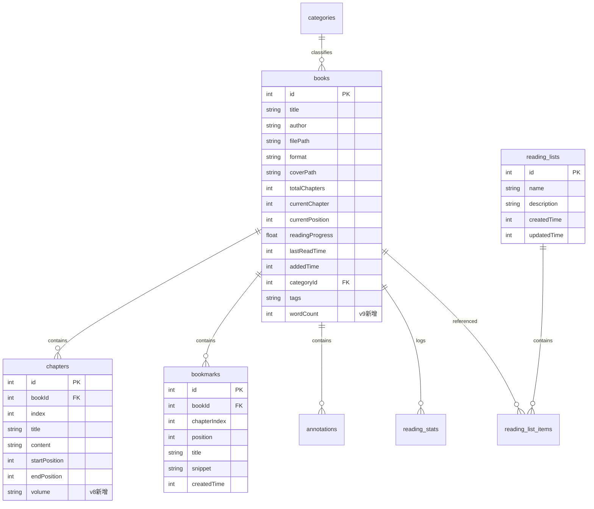

# FlowReader 全量工程策划与技术白皮书
> **版本**：v0.1.6（versionCode: 5667） · **状态**：全功能稳定可用 / 门禁全绿（56 项测试套件 · 83.6% 覆盖广度）  
> **文档定位**：全量工程架构规范、功能资产盘点与接手开发指南。后续任何 AI 智能体或开发者通读本文档即可零门槛无缝接手项目。

---

## 目录
1. [项目基本概况与核心定位](#一项目基本概况与核心定位)
2. [技术栈规格与架构蓝图](#二技术栈规格与架构蓝图)
3. [模块分层与代码物理地图](#三模块分层与代码物理地图)
4. [数据架构与持久化规范 (Room v9 + DataStore)](#四数据架构与持久化规范)
5. [排版引擎与核心交互算法](#五排版引擎与核心交互算法)
6. [已实现功能全量清单与状态矩阵](#六已实现功能全量清单与状态矩阵)
7. [质量保障体系与自动化门禁](#七质量保障体系与自动化门禁)
8. [已知技术债与未来演进路线图](#八已知技术债与未来演进路线图)
9. [新接手开发者 / AI 快速上手指引](#九新接手开发者--ai-快速上手指引)

---

## 一、项目基本概况与核心定位

### 1.1 产品愿景
**FlowReader** 是一款面向 Android 平台的高性能、原生、纯净且注重隐私的现代本地阅读器。针对中文阅读（CJK 排版）进行深度定制，致力于提供媲美掌阅、微信读书的精致排版质感，同时坚守开源纯本地软件的无侵害性底线。

### 1.2 核心设计哲学
- **隐私与安全绝对优先**：
  - **零账号、零网络上报、零统计埋点、零外部广告 SDK**。
  - 清晰的网络权限边界：声明 `android.permission.INTERNET`，但**严格且仅用于**局域网 Wi-Fi 传书（`LanTransferServer`）与私有 OPDS 书库拉取（`OpdsClient`），没有任何外部遥测请求。
  - **零 WebView 依赖**：全应用正文解析与排版全部基于 Compose 纯原生 Canvas / TextLayout，坚决摒弃嵌入式 Web 容器带来的内存膨胀、白屏与脚本注入风险。
  - **安全沙箱**：ContentProvider 仅暴露只读图书元数据；FileProvider 严格限制在 `cache/share_cards/` 导出临时目录。
- **中文排版（CJK）极致质感**：
  - 具备真实按物理像素分页（逐页测量换行）、垂直平滑滚动与无动画快速翻页三种模式。
  - 严格遵循中文版式规则：段落首行强制缩进 2 字符、两端对齐（Justify）、标点避头尾法则、行间距/段间距动态自适应。
  - 预设 19 套高雅阅读色板（100% 通过 WCAG AA 级 4.5:1 对比度自动化测试）与 4 种微米级 Canvas 纸质噪点纹理。
  - 双套 UI 品牌主题：**Scheme A（墨韵雅致 / 暖纸琥珀）** 与 **Scheme C（玄墨极简 / 冷灰墨黑）**，并支持 Android 12+ 壁纸动态取色（Dynamic Monochromatic）。
- **极度严苛的工程交付标准**：
  - 维持全量三道自动化门禁：ktlint + 空白字符检测、83.6% 覆盖广度单测套件、编译产物基线。

---

## 二、技术栈规格与架构蓝图

### 2.1 依赖环境与编译规格
| 维度 | 版本 / 规范 | 详细说明 |
|---|---|---|
| **操作系统支持** | Android 8.0+ (API 26) ~ Android 15 (API 35) | `minSdk = 26`, `compileSdk = 35`, `targetSdk = 35` |
| **开发语言** | Kotlin 2.1.0 | 启用全模块强类型空安全与协程支持 |
| **构建系统** | Gradle 8.6.0 + AGP 8.6.0 + KSP 2.1.0-1.0.29 | Java 17 兼容编译，启用 JDK 核心库脱糖 (`desugar_jdk_libs:2.0.4`) |
| **UI 声明式框架** | Jetpack Compose (BOM 2024.12.01) | Compose Compiler 2.1.0，配合 `compose_compiler_config.conf` 保持模型稳定性 |
| **Material 规范** | Material 3 (`androidx.compose.material3`) | 定制去除 M3 默认蓝紫高亮，打造专属 FlowTokens 设计系统 |
| **依赖注入** | Dagger Hilt 2.55 | 单例作用域容器与 ViewModel 自动化注入 |
| **本地持久化** | Room 2.6.1 + DataStore Preferences 1.1.1 | Room Schema v9 完整手写迁移脚本；DataStore 纳管全局阅读配置 |
| **异步流与并发** | Kotlin Coroutines 1.9.0 + StateFlow | 响应式单向数据流 (UDF) 驱动 UI 渲染 |
| **生物识别** | AndroidX Biometric 1.1.0 | 支持指纹与系统凭证解锁应用锁 |
| **图书/文档渲染** | Readium Kotlin Toolkit 3.1.2 + Jsoup 1.18.3 | EPUB / MOBI / FB2 / PDF / TXT 原生解析链路 |
| **自动化测试** | JUnit 4 + Robolectric 4.14.1 + Roborazzi 1.40.0 + MockK | 包含模型合同、对比度算法、排版断行、Room 迁移验证 |

### 2.2 架构全景分层 (Clean Architecture)
```mermaid
flowchart TB
    subgraph UI_Layer [UI 层 (Jetpack Compose)]
        A1[MainActivity / FlowReaderApp] --> A2[Navigation 路由中枢]
        A2 --> A3[LibraryScreen 书架]
        A2 --> A4[ReaderScreen 阅读核心]
        A2 --> A5[BookDetailScreen / BookStatsScreen 详情与统计]
        A2 --> A6[SettingsScreen 全局分级设置]
        A2 --> A7[NotesScreen / SearchScreen / OpdsScreen]
    end

    subgraph ViewModel_Layer [ViewModel 状态驱动层]
        VM1[LibraryViewModel]
        VM2[ReaderViewModel]
        VM3[BookDetailViewModel / StatsViewModel]
        VM4[SettingsViewModel]
    end

    subgraph Feature_Layer [Feature 核心特性层]
        F1[:feature:reader]
        F1 --- F1_1[ChapterPaginator 逐页测绘]
        F1 --- F1_2[ReaderPosition / ReaderProgress]
        F1 --- F1_3[ReaderSession 追踪器]
        F2[:feature:library]
    end

    subgraph Core_Layer [Core 基础与设计系统]
        C1[FlowTokens / FlowBrandColors / FlowTheme]
        C2[ReaderMetrics / ReaderTypography / ReaderPalette]
        C3[ChineseConverter 简繁转换引擎]
        C4[TxtCleaner 文本净化 / ChapterBody]
        C5[ColorContrast 对比度计算]
    end

    subgraph Domain_Layer [Domain 纯业务领域模型]
        D1[Book / Chapter / Bookmark / Annotation]
        D2[ReadingSettings / TxtProcessingRules]
        D3[Repository 抽象接口定义]
    end

    subgraph Data_Layer [Data 数据持久化层]
        DA1[AppDatabase Room v9]
        DA2[BookDao / ChapterDao / StatsDao 等 7 大 DAO]
        DA3[DataStore Preferences]
        DA4[RepositoryImpl 具体实现]
    end

    UI_Layer --> ViewModel_Layer
    ViewModel_Layer --> Feature_Layer
    ViewModel_Layer --> Domain_Layer
    Feature_Layer --> Core_Layer
    Feature_Layer --> Domain_Layer
    Data_Layer --> Domain_Layer
    Data_Layer --> DA1
    DA1 --> DA2
```

---

## 三、模块分层与代码物理地图

项目工作区物理路径：`C:\Users\lenovo\.dsh\agy-link\media\flowreader`

### 3.1 模块职责与依赖关系表
| 模块名称 | 物理路径 | 核心职责 | 关键依赖 |
|---|---|---|---|
| `:app` | `app/` | 应用装配外壳、Compose 页面装配、Hilt 依赖图注入、文件解析导入器、通知与系统交互 | `:core`, `:data`, `:domain`, `:feature:reader`, `:feature:library` |
| `:feature:reader` | `feature/reader/` | 高性能排版测量核心、分页计算、阅读进度换算、阅读会话追踪器 | `:core`, `:domain` |
| `:feature:library` | `feature/library/` | 书架展示特性插槽（预留解耦模块） | `:core`, `:domain` |
| `:core` | `core/` | 设计系统 Token、颜色/间距/阴影、阅读器色板与字体排印规范、文本清洗与简繁转换等纯算法工具 | 纯纯基础库（无业务模型依赖） |
| `:domain` | `domain/` | 纯 Kotlin 领域实体、配置类、Repository 接口定义（不含 Android SDK 依赖） | 零平台依赖，受 `compose_compiler_config.conf` 保护 |
| `:data` | `data/` | Room 数据库定义（`AppDatabase`）、8 大 Entity、7 大 DAO、Room 历史 Schema 镜像 | `:domain`, Room KSP |

---

### 3.2 核心代码文件物理索引

#### 3.2.1 `:core` (基础与排版算法)
- [FlowTokens.kt](file:///C:/Users/lenovo/.dsh/agy-link/media/flowreader/core/src/main/java/com/flowreader/app/core/designsystem/token/FlowTokens.kt): 基础排版、圆角 (`FlowRadius`)、间距 (`FlowSpacing`)、阴影 (`FlowElevation`) 规范。
- [FlowBrandColors.kt](file:///C:/Users/lenovo/.dsh/agy-link/media/flowreader/core/src/main/java/com/flowreader/app/core/designsystem/token/FlowBrandColors.kt): Scheme A (墨韵雅致) 与 Scheme C (玄墨极简) 双主题调色板定义。
- [FlowTheme.kt](file:///C:/Users/lenovo/.dsh/agy-link/media/flowreader/core/src/main/java/com/flowreader/app/core/designsystem/theme/FlowTheme.kt): 全局 Compose 主题入口，支持亮暗模式、壁纸动态取色 (Dynamic Monochromatic) 与品牌色注入。
- [ReaderMetrics.kt](file:///C:/Users/lenovo/.dsh/agy-link/media/flowreader/core/src/main/java/com/flowreader/app/core/designsystem/reader/ReaderMetrics.kt): 边距与文本排版物理参数计算。
- [ReaderPalette.kt](file:///C:/Users/lenovo/.dsh/agy-link/media/flowreader/core/src/main/java/com/flowreader/app/core/designsystem/reader/ReaderPalette.kt): 19 款阅读色板（羊皮纸、水墨、深邃暗黑等）及其 WCAG 对比度保障。
- [ReaderTypography.kt](file:///C:/Users/lenovo/.dsh/agy-link/media/flowreader/core/src/main/java/com/flowreader/app/core/designsystem/reader/ReaderTypography.kt): 阅读器专属字号、行距、段距 TextStyle 生成。
- [ChineseConverter.kt](file:///C:/Users/lenovo/.dsh/agy-link/media/flowreader/core/src/main/java/com/flowreader/app/core/util/ChineseConverter.kt) & [ChineseConversionTable.kt](file:///C:/Users/lenovo/.dsh/agy-link/media/flowreader/core/src/main/java/com/flowreader/app/core/util/ChineseConversionTable.kt): 基于 Trie 树的高性能纯 Kotlin OpenCC 简繁互转算法。
- [TxtCleaner.kt](file:///C:/Users/lenovo/.dsh/agy-link/media/flowreader/core/src/main/java/com/flowreader/app/core/util/TxtCleaner.kt): TXT 广告行清洗、空行折叠、段首标准双全角空格规范化。
- [ColorContrast.kt](file:///C:/Users/lenovo/.dsh/agy-link/media/flowreader/core/src/main/java/com/flowreader/app/core/util/ColorContrast.kt): 相对亮度与 WCAG AA/AAA 对比度断言算法。

#### 3.2.2 `:domain` (实体与业务契约)
- [Book.kt](file:///C:/Users/lenovo/.dsh/agy-link/media/flowreader/domain/src/main/java/com/flowreader/app/domain/model/Book.kt): 图书实体（含 `wordCount`、`readingProgress`、`totalChapters` 等）。
- [Chapter.kt](file:///C:/Users/lenovo/.dsh/agy-link/media/flowreader/domain/src/main/java/com/flowreader/app/domain/model/Chapter.kt): 章节实体（包含 `volume` 分卷标识与正文偏移）。
- [ReadingSettings.kt](file:///C:/Users/lenovo/.dsh/agy-link/media/flowreader/domain/src/main/java/com/flowreader/app/domain/model/ReadingSettings.kt): 阅读配置聚合根（翻页模式、字体族、间距、主题色、手势映射）。
- [TxtProcessingRules.kt](file:///C:/Users/lenovo/.dsh/agy-link/media/flowreader/domain/src/main/java/com/flowreader/app/domain/model/TxtProcessingRules.kt): TXT 自定义净化与正则分章规则。
- [ReadingStats.kt](file:///C:/Users/lenovo/.dsh/agy-link/media/flowreader/domain/src/main/java/com/flowreader/app/domain/model/ReadingStats.kt): 阅读时长、已读页数统计数据结构。

#### 3.2.3 `:feature:reader` (分页与排版核心)
- [ChapterPaginator.kt](file:///C:/Users/lenovo/.dsh/agy-link/media/flowreader/feature/reader/src/main/java/com/flowreader/feature/reader/ChapterPaginator.kt): 逐页测量排版引擎。利用 Android TextLayout 精准计算每页能容纳的字符起止位置。
- [ReaderPosition.kt](file:///C:/Users/lenovo/.dsh/agy-link/media/flowreader/feature/reader/src/main/java/com/flowreader/feature/reader/ReaderPosition.kt): 章节索引、页码、字符偏移坐标模型。
- [ReaderProgress.kt](file:///C:/Users/lenovo/.dsh/agy-link/media/flowreader/feature/reader/src/main/java/com/flowreader/feature/reader/ReaderProgress.kt): 全书综合阅读进度算法。
- [ReaderSession.kt](file:///C:/Users/lenovo/.dsh/agy-link/media/flowreader/feature/reader/src/main/java/com/flowreader/feature/reader/ReaderSession.kt): 阅读心跳与单次会话统计监控器。

#### 3.2.4 `:data` (持久化架构)
- [AppDatabase.kt](file:///C:/Users/lenovo/.dsh/agy-link/media/flowreader/data/src/main/java/com/flowreader/app/data/local/AppDatabase.kt): Room 数据库，当前版本 9。
- `data/src/main/java/com/flowreader/app/data/local/entity/`:
  - `BookEntity.kt`, `ChapterEntity.kt`, `BookmarkEntity.kt`, `AnnotationEntity.kt`, `CategoryEntity.kt`, `ReadingStatsEntity.kt`, `ReadingListEntity.kt`, `ReadingListItemEntity.kt`.
- `data/src/main/java/com/flowreader/app/data/local/dao/`:
  - `BookDao.kt`, `ChapterDao.kt`, `BookmarkDao.kt`, `AnnotationDao.kt`, `CategoryDao.kt`, `ReadingStatsDao.kt`, `ReadingListDao.kt`.

#### 3.2.5 `:app` (UI、视图模型与工具集成)
- **UI 框架与路由**：
  - [Navigation.kt](file:///C:/Users/lenovo/.dsh/agy-link/media/flowreader/app/src/main/java/com/flowreader/app/ui/Navigation.kt): 全应用 Compose Navigation 图，声明 64dp 纤细底栏与微圆点指示器。
  - [FlowReaderApp.kt](file:///C:/Users/lenovo/.dsh/agy-link/media/flowreader/app/src/main/java/com/flowreader/app/ui/FlowReaderApp.kt): 顶层 Scaffold 与模态交互宿主。
  - [AppLockScreen.kt](file:///C:/Users/lenovo/.dsh/agy-link/media/flowreader/app/src/main/java/com/flowreader/app/ui/AppLockScreen.kt): 生物识别指纹与 PIN 码应用锁界面。
- **阅读界面组件群 (`ui/screens/reader/`)**：
  - [ReaderScreen.kt](file:///C:/Users/lenovo/.dsh/agy-link/media/flowreader/app/src/main/java/com/flowreader/app/ui/screens/reader/ReaderScreen.kt) & [ReaderViewModel.kt](file:///C:/Users/lenovo/.dsh/agy-link/media/flowreader/app/src/main/java/com/flowreader/app/ui/screens/reader/ReaderViewModel.kt): 阅读页入口与状态机。
  - [PagedReader.kt](file:///C:/Users/lenovo/.dsh/agy-link/media/flowreader/app/src/main/java/com/flowreader/app/ui/screens/reader/components/PagedReader.kt): 核心分页视图，实现 `preScroll`/`preFling` 边界跨章滑动手势与 280ms 侧边防重复连击翻页。
  - [ReaderContent.kt](file:///C:/Users/lenovo/.dsh/agy-link/media/flowreader/app/src/main/java/com/flowreader/app/ui/screens/reader/components/ReaderContent.kt): 统一边距与系统 Insets 计算，下发 PageContent 渲染。
  - [ReaderHeader.kt](file:///C:/Users/lenovo/.dsh/agy-link/media/flowreader/app/src/main/java/com/flowreader/app/ui/screens/reader/components/ReaderHeader.kt): 顶栏 11sp 章节标题显示，支持状态栏与挖孔避让。
  - [ReaderFooter.kt](file:///C:/Users/lenovo/.dsh/agy-link/media/flowreader/app/src/main/java/com/flowreader/app/ui/screens/reader/components/ReaderFooter.kt): 底栏均衡排版，左侧进度百分比，右侧当前时间与 Canvas 矢量微型电池图标。
  - [ReaderTapGestures.kt](file:///C:/Users/lenovo/.dsh/agy-link/media/flowreader/app/src/main/java/com/flowreader/app/ui/screens/reader/components/ReaderTapGestures.kt): 严格包含 `touchSlop` 防抖过滤的点按与手势分发器。
  - [ReaderControls.kt](file:///C:/Users/lenovo/.dsh/agy-link/media/flowreader/app/src/main/java/com/flowreader/app/ui/screens/reader/components/ReaderControls.kt) & [ReaderSettingsSheet.kt](file:///C:/Users/lenovo/.dsh/agy-link/media/flowreader/app/src/main/java/com/flowreader/app/ui/screens/reader/components/ReaderSettingsSheet.kt): 掌阅式底部弹出控制面板与排版快速调谐抽屉。
  - [ReaderTocSheet.kt](file:///C:/Users/lenovo/.dsh/agy-link/media/flowreader/app/src/main/java/com/flowreader/app/ui/screens/reader/components/ReaderTocSheet.kt): 支持分卷折叠的目录、书签、笔记三合一抽屉。
- **书架与详情**：
  - [LibraryScreen.kt](file:///C:/Users/lenovo/.dsh/agy-link/media/flowreader/app/src/main/java/com/flowreader/app/ui/screens/library/LibraryScreen.kt): 微凸浮雕胶囊分组与筛选卡片书架。
  - [BookDetailScreen.kt](file:///C:/Users/lenovo/.dsh/agy-link/media/flowreader/app/src/main/java/com/flowreader/app/ui/screens/bookdetail/BookDetailScreen.kt): 精简概览（字数、总章数、简介、目录预览）。
  - [BookStatsScreen.kt](file:///C:/Users/lenovo/.dsh/agy-link/media/flowreader/app/src/main/java/com/flowreader/app/ui/screens/bookdetail/BookStatsScreen.kt): 掌阅式二级独立阅读统计详情页。
- **后台与工具层 (`util/`)**：
  - [BookParser.kt](file:///C:/Users/lenovo/.dsh/agy-link/media/flowreader/app/util/BookParser.kt): 全格式图书解析中枢，计算总字数 `wordCount`。
  - [TxtChapterDetector.kt](file:///C:/Users/lenovo/.dsh/agy-link/media/flowreader/app/util/TxtChapterDetector.kt): 智能中文分章正则检测引擎。
  - [AppLockManager.kt](file:///C:/Users/lenovo/.dsh/agy-link/media/flowreader/app/util/AppLockManager.kt): 生物认证状态机与超时自动加锁逻辑。
  - [CustomFontImporter.kt](file:///C:/Users/lenovo/.dsh/agy-link/media/flowreader/app/util/CustomFontImporter.kt): 外部 `.ttf`/`.otf` 自定义字体沙箱导入。
  - [FolderScanner.kt](file:///C:/Users/lenovo/.dsh/agy-link/media/flowreader/app/util/FolderScanner.kt): SAF DocumentFile 树形目录后台异步扫书。
  - [VolumeKeyHandler.kt](file:///C:/Users/lenovo/.dsh/agy-link/media/flowreader/app/util/VolumeKeyHandler.kt): 硬件音量键翻页拦截器。
  - [LanTransferServer.kt](file:///C:/Users/lenovo/.dsh/agy-link/media/flowreader/app/util/LanTransferServer.kt): 嵌入式微型 HTTP 局域网 Wi-Fi 传书服务。

---

## 四、数据架构与持久化规范

### 4.1 Room 数据库设计 (Database Version 9)
数据库名：`flowreader_db`，由 [AppDatabase.kt](file:///C:/Users/lenovo/.dsh/agy-link/media/flowreader/data/src/main/java/com/flowreader/app/data/local/AppDatabase.kt) 声明，当前包含 8 张实体表。



### 4.2 实体表结构定义
1. **`books` (书籍主表)**:
   - `id`: 主键自增 (Int)
   - `title`: 书名 (String), `author`: 作者 (String), `filePath`: 本地文件绝对路径 (String)
   - `format`: 格式扩展名 (TXT, EPUB, MOBI, PDF, FB2, ZIP)
   - `coverPath`: 封面缓存路径 (String?)
   - `totalChapters`: 总章数 (Int), `currentChapter`: 当前阅读章节索引 (Int), `currentPosition`: 章节内字符偏移量 (Int)
   - `readingProgress`: 全书进度浮点百分比 (Float)
   - `lastReadTime`: 最后阅读时间戳 (Long), `addedTime`: 导入时间戳 (Long)
   - `categoryId`: 所属分类 ID (Int, 默认 0)
   - `tags`: 逗号分隔的标签字符串 (String, 默认 `""`)
   - `wordCount`: 全书总非空白字符统计 (Int, 默认 0, **Schema v9 新增**)
2. **`chapters` (章节表)**:
   - `id`: 主键自增 (Int)
   - `bookId`: 外键关联 `books.id` (Int, 建立索引, 支持级联删除)
   - `index`: 章节顺序索引 (Int)
   - `title`: 章节标题 (String)
   - `content`: 章节正文文本 (String)
   - `startPosition` / `endPosition`: 原始文件字节偏移 (Int)
   - `volume`: 所属分卷名 (String?, **Schema v8 新增**)
3. **`bookmarks` (书签表)**:
   - `id`: 主键自增, `bookId`: 书籍 ID, `chapterIndex`: 章节索引, `position`: 字符偏移, `title`: 标签, `snippet`: 正文摘要, `createdTime`: 创建时间。
   - 建立复合索引：`index_bookmarks_bookId_chapterIndex_position`。
4. **`annotations` (划线与笔记表)**:
   - `id`: 主键, `bookId`: 外键, `chapterIndex`: 章节索引, `startPosition` / `endPosition`: 选区字符起止, `selectedText`: 划线文字, `note`: 用户批注文本, `color`: 高亮颜色 HEX (String), `createdTime`: 时间戳。
5. **`categories` (书籍分组分类表)**:
   - `id`: 主键, `name`: 分组名称 (String), `displayOrder`: 排序序号 (Int)。
6. **`reading_stats` (每日阅读统计表)**:
   - `id`: 主键, `date`: 日期字符串 (`YYYY-MM-DD`, 唯一索引), `totalDurationSeconds`: 累计阅读时长 (Long), `pagesRead`: 翻页次数 (Int), `booksRead`: 涉及书籍数 (Int)。
7. **`reading_lists` & `reading_list_items` (自定义书单系统, Schema v7 新增)**:
   - 具备外键级联删除与 `(listId, bookId)` 唯一性约束。

### 4.3 数据库版本迁移图谱
所有 Migration 在 [AppModule.kt](file:///C:/Users/lenovo/.dsh/agy-link/media/flowreader/app/src/main/java/com/flowreader/app/di/AppModule.kt) 中以严格单调递增的显式 SQL 实现，并通过单元测试校验完整性：
- **`MIGRATION_4_5` (v4 -> v5)**: 为 `books` 表增加 `tags TEXT NOT NULL DEFAULT ''`。
- **`MIGRATION_5_6` (v5 -> v6)**: 创建 `bookmarks` 表的 `(bookId, chapterIndex, position)` 复合查询索引。
- **`MIGRATION_6_7` (v6 -> v7)**: 创建 `reading_lists` 与 `reading_list_items` 表及相关外键索引。
- **`MIGRATION_7_8` (v7 -> v8)**: 为 `chapters` 表添加 `volume TEXT` 字段，支持中文小说分卷展示。
- **`MIGRATION_8_9` (v8 -> v9)**: 为 `books` 表添加 `wordCount INTEGER NOT NULL DEFAULT 0`，支持字数统计。

---

## 五、排版引擎与核心交互算法

### 5.1 逐页测量排版机制 (`ChapterPaginator`)
为了达成媲美纸质书的稳定排版，FlowReader 拒绝动态折行导致的浮动跳页，采用精准离线分段算法：
1. **可用空间裁决 (Viewport Insets Safe-zone)**：
   $$\text{AvailableWidth} = \text{ScreenWidthPx} - 2 \times \text{HorizontalPaddingPx}$$
   $$\text{AvailableHeight} = \text{ScreenHeightPx} - \text{TopInsetPx} - \text{BottomInsetPx}$$
   - `TopInsetPx` = 状态栏 / 挖孔高度 + 顶部栏高度 (36dp) + **正文呼吸安全间隔 (20dp)**。
   - `BottomInsetPx` = 导航栏高度 + 底部状态栏高度 (32dp) + 底栏间距 (8dp)。
2. **TextLayout 测量与折行**：
   - 将章节文本按段落切分，为每段应用首行缩进两个全角汉字字符 (`\u3000\u3000`)。
   - 通过 Android `StaticLayout` / Compose `TextMeasurer`，使用当前选定字体族的度量矩阵（行高、字号、段间距）进行仿真排版。
   - 逐行累加行高，当累计高度超过 `AvailableHeight` 时，以行边界（Line End）作为物理分页切分点，输出 `List<PageFragment>`。

### 5.2 边界跨章滑动手势引擎 (Overscroll / Pre-scroll / Pre-fling)
针对 Compose 1.7+ `HorizontalPager` 的默认 OverScroll 效果会吞噬边界滚动手势的缺陷，FlowReader 在 [PagedReader.kt](file:///C:/Users/lenovo/.dsh/agy-link/media/flowreader/app/ui/screens/reader/components/PagedReader.kt) 中构建了专属 `NestedScrollConnection` 拦截器：
- **`onPreScroll(available, source)`**：
  - 当处于最后一页且用户继续向左滑（`available.x < 0`），或处于第一页向右滑（`available.x > 0`）：
  - 累加位移变量 `overscrollAccumulator`。
  - 一旦滑动位移超过阈值 `OVER_SCROLL_SWITCH_THRESHOLD_DP = 56.dp`，且冷却时间未被激活，立即触发 `onNextChapter()` 或 `onPreviousChapter()`。
  - 返回 `available` 消耗手势，防止 Compose 内部回弹动画吞噬位移。
- **`onPreFling(available)`**：
  - 若用户在章节末页/首页快速甩动（Fling Velocity > 350 px/s 且方向朝向边界），立即判定为翻章意图，直接跨章并消费速度，返回 `available`。
- **对称重置与状态保护**：
  - 翻到下一章时，自动重置目标阅读位置为第 0 页顶部 (`positionOverride = 0, landAtEnd = false`)；
  - 翻到上一章时，重置目标位置到末页最后一字 (`landAtEnd = true`)；
  - 引入 800ms 章节切换互斥锁 `isSwitchingChapter`，彻底消除翻章过程中的界面闪跳或反复折返。

### 5.3 屏幕边侧点按防抖与误触消除 (`ReaderTapGestures`)
针对快速连点屏幕导致跳翻多页的问题，构筑三道防护盾：
1. **滑动过滤 (TouchSlop Check)**：在指针由 `ACTION_DOWN` 到 `ACTION_UP` 的移动轨迹中，如果曼哈顿位移大于系统 `viewConfiguration.touchSlop`，直接标识为拖动或滑动手势，不再触发点击翻页。
2. **消费确认 (`up.consume()`)**：抬手事件一旦被手势探测器承接，立即显式 consume，阻断多层监听器重复派发。
3. **时钟防抖闸门 (280ms Debounce Gate)**：
   ```kotlin
   val now = System.currentTimeMillis()
   if (now - lastPageTurnTime < 280L || pagerState.isScrollInProgress) {
       return // 严格丢弃动画未完成期间或过于密集的后续点击
   }
   lastPageTurnTime = now
   ```

### 5.4 文本净化与简繁转换算法
1. **TXT 广告与格式净化 ([TxtCleaner.kt](file:///C:/Users/lenovo/.dsh/agy-link/media/flowreader/core/src/main/java/com/flowreader/app/core/util/TxtCleaner.kt))**:
   - 过滤网络小说中常见的广告行（如“求月票”、“最新章节请访问……”、“本章完”等常见水印行）。
   - 折叠多余连续空行（三个以上换行归一化为单个空行）。
   - 规范化段首缩进：清除段首无序的制表符和空格，统一格式化为标准中文双全角空格。
2. **纯原生简繁转换 ([ChineseConverter.kt](file:///C:/Users/lenovo/.dsh/agy-link/media/flowreader/core/src/main/java/com/flowreader/app/core/util/ChineseConverter.kt))**:
   - 基于纯 Kotlin 构建的双向词典树，零依赖、零 JNI、毫秒级转化，支持简体中文与繁体中文（台标/港标/通用繁体）的高保真瞬时转换。

---

## 六、已实现功能全量清单与状态矩阵

| 业务模块 | 功能项 | 对应关键代码路径 | 当前交付状态 |
|---|---|---|---|
| **书架系统** | 网格与列表双视图自由切换 | `ui/screens/library/LibraryScreen.kt` | ✅ 稳定（支持 2~6 列可调） |
| | 书架分组分类管理（创建/重命名/删除/移入） | `domain/model/Category.kt`, `CategoryDao.kt` | ✅ 稳定 |
| | 独立书单系统 (ReadingList) | `ReadingListRepositoryImpl.kt` | ✅ 稳定 |
| | 标签 (Tags) 快速过滤筛选胶囊 | `ui/screens/library/ReadingFilter.kt` | ✅ 稳定（微凸质感胶囊） |
| | 本地存储目录扫描 (SAF DocumentFile) | `util/FolderScanner.kt` | ✅ 稳定（后台异步扫描） |
| | 已读书籍点击直进阅读页 | `LibraryViewModel.kt` | ✅ 稳定 |
| **格式解析** | TXT 智能分章（汉字数字、卷、回、节、番外） | `util/TxtChapterDetector.kt` | ✅ 稳定（高精度正则） |
| | EPUB 原生流式与插图解析、分卷保留 | `util/BookParser.kt`, Readium Toolkit | ✅ 稳定 |
| | MOBI / AZW / AZW3 解析支持 | `util/MobiParser.kt` | ✅ 稳定 |
| | FB2 格式解析 | `util/Fb2Parser.kt` | ✅ 稳定 |
| | PDF 基础翻页与缩放视图 | `ui/screens/reader/components/PdfViewer.kt` | ✅ 稳定 |
| | ZIP 压缩包批量导入解压 | `util/ZipImporter.kt` | ✅ 稳定 |
| **阅读核心** | 真实逐页物理分页排版 | `feature/reader/ChapterPaginator.kt` | ✅ 稳定（精准断行） |
| | 垂直平滑滚动阅读模式 | `components/ScrollReader.kt` | ✅ 稳定 |
| | 左右覆盖与仿真无动画翻页 | `components/PagedReader.kt` | ✅ 稳定 |
| | 边界跨章滑动手势与 Fling 加速 | `components/PagedReader.kt` | ✅ 稳定（56dp/350px 判定） |
| | 边侧防抖点击翻页 (280ms) | `components/ReaderTapGestures.kt` | ✅ 稳定 |
| | 硬件物理音量键翻页 | `util/VolumeKeyHandler.kt` | ✅ 稳定 |
| | 顶栏章节名 + 避让挖孔 | `components/ReaderHeader.kt` | ✅ 稳定（11sp 极简顶栏） |
| | 底栏进度百分比 + 矢量微型电池图标 | `components/ReaderFooter.kt` | ✅ 稳定（Canvas 实时电量） |
| | 屏幕中下部拖动进度气泡 HUD | `components/ReadingProgressHud.kt` | ✅ 稳定 |
| **排版与视效** | 19 套高雅阅读预设色板 | `core/designsystem/reader/ReaderPalette.kt` | ✅ 稳定（全量过 WCAG AA） |
| | 4 套微米级纸质噪点纹理生成器 | `util/PaperTextureGenerator.kt` | ✅ 稳定 |
| | 自定义字体导入 (.ttf / .otf) | `util/CustomFontImporter.kt` | ✅ 稳定（沙箱缓存隔离） |
| | 简繁体中文瞬时切换 | `core/util/ChineseConverter.kt` | ✅ 稳定 |
| | TXT 广告清洗与缩进规范化 | `core/util/TxtCleaner.kt` | ✅ 稳定 |
| | 护眼蓝光过滤色温调节与夜间自动切换 | `ReadingSettings.kt`, `ReaderScreen.kt` | ✅ 稳定 |
| **书内导航** | 目录抽屉（支持分卷折叠） | `components/ReaderTocSheet.kt` | ✅ 稳定 |
| | 书签与划线笔记高亮记录 | `BookmarkListDialog.kt`, `AnnotationDao.kt` | ✅ 稳定 |
| | 笔记导出（Markdown / HTML / TXT） | `core/util/AnnotationExporter.kt` | ✅ 稳定 |
| | FTS5 全文搜索与关键词高亮跳转 | `util/FullTextSearch.kt` | ✅ 稳定 |
| **统计与详情** | 书籍全书字数统计 (`wordCount`) | `domain/model/Book.kt` (Room v9) | ✅ 稳定（导入时预计算） |
| | 掌阅式独立二级书籍统计页 | `ui/screens/bookdetail/BookStatsScreen.kt`| ✅ 稳定 |
| | 每日/每周/每月阅读时长柱状图与报表 | `ui/screens/stats/StatsScreen.kt` | ✅ 稳定 |
| | 桌面小组件 (AppWidget) 阅读进度展示 | `widget/ReadingProgressWidgetProvider.kt` | ✅ 稳定 |
| **系统与安全** | 生物识别指纹与密码应用锁 | `util/AppLockManager.kt`, `AppLockScreen` | ✅ 稳定（后台切出自动锁） |
| | 局域网 Wi-Fi 传书服务 (HTTP Server) | `util/LanTransferServer.kt` | ✅ 稳定 |
| | 内网私有 OPDS 书库浏览与下载 | `util/OpdsClient.kt`, `OpdsScreen.kt` | ✅ 稳定 |
| | 数据全量备份与还原 (JSON/ZIP) | `data/repository/BackupRepository.kt` | ✅ 稳定（原子性保障） |

---

## 七、质量保障体系与自动化门禁

本项目部署了三重递进式自动化校验网，在任何提交或构建前必须全部通过：

### 7.1 门禁命令矩阵
| 门禁类型 | 执行命令 | 门禁规则与断言标准 |
|---|---|---|
| **代码规范门禁** | `.\gradlew verifyKotlinStyle` | 执行 ktlint 检查；强制扫描源码树中的制表符 (`\t`) 与行尾空格，有任意违规直接构建失败。 |
| **逻辑与回归测试** | `.\gradlew testDebugUnitTest` | 运行全部 56 个单元测试类，包含算法边界、模型稳定性、对比度合规性。 |
| **测试广度门禁** | `.\gradlew coverageSummary` | 计算核心层代码与测试类覆盖比例，**测试文件广度必须 ≥ 40%**（当前实测为 **83.6%**）。 |
| **体积基线监控** | `.\gradlew performanceBaseline` | 对比 `baseline/apk-size.properties`，产物异常膨胀时抛出警告。 |
| **一键式总控门禁** | `pwsh -NoProfile -File tools\verify.ps1` | 一键顺序串联代码风格、全量单测与 APK 编译组装。 |

---

## 八、已知技术债与未来演进路线图

### 8.1 待治理的技术债
1. **模块依赖收敛**：
   - 目前部分 Repository 实现类（如 `BookRepositoryImpl.kt` 等）暂放在 `:app` 的 `data/repository/` 目录下，后续应完全沉降迁移至独立的 `:data` 模块中。
   - `:feature:library` 模块目录已创建，但实际书架 UI 目前仍在 `:app:ui:screens:library`，后续版本应完成物理切分。
2. **听书 (TTS) 能力升级**：
   - 当前 `TtsManager` 仅具备基础播放与暂停，缺乏语速微调、变调、MediaSession 锁屏后台播放控件与阅读进度实时高亮对齐联动。

### 8.2 下一阶段演进规划 (v0.2.0+)
- **P0: WebDAV 进度与书库双向无缝云同步**：
  - 支持坚果云、Nextcloud 等标准 WebDAV 协议，同步阅读进度、书签、划线笔记及书架元数据。
- **P1: 本地离线词典与划词翻译**：
  - 引入 StarDict / MDX 本地词典解析引擎，长按选词即时浮窗释义。
- **P2: 听书 MediaSession 升级**：
  - 接入 Android `MediaSessionCompat`，提供系统通知栏媒体控件、耳机线控与锁屏播放控制。
- **P3: AI 本地/私有模型辅助阅读**：
  - 接入本地/远程兼容 OpenAI 格式 API，提供长文速读、角色关系谱生成与段落润色释义。

---

## 九、新接手开发者 / AI 快速上手指引

### 9.1 环境准备
- 必须使用 **PowerShell 7 (`pwsh`)** 运行脚本。**切勿使用 Windows 自带的 PowerShell 5.1**，因 5.1 默认编码非 UTF-8，会导致含中文的源文件被截断破坏。
- JDK 版本要求：Java 17（推荐 JDK 17.0.x）。

### 9.2 常用日常工作流指令
```powershell
# 1. 启动全量自动化验证门禁（提交代码前必跑）
pwsh -NoProfile -File tools\verify.ps1

# 2. 查看当前测试覆盖广度指标
.\gradlew.bat coverageSummary --console=plain

# 3. 仅构建 Debug 安装包
.\gradlew.bat :app:assembleDebug --console=plain

# 4. 通过 ADB 部署并安装到已连接手机设备
adb install -r app\build\outputs\apk\debug\app-debug.apk

# 5. 启动 App 并抓取相关运行时日志
adb shell am start -n com.flowreader.app/.MainActivity
adb logcat -v time | Select-String "FlowReader"
```

### 9.3 核心开发纪律（红线准则）
1. **禁止引入任何外部广告、分析打点或侵犯隐私的 SDK**。
2. **禁止在阅读核心使用 WebView**。
3. **数据架构演进约束**：
   - 严禁擅自修改已存在的 Room 历史 Migration 脚本（`MIGRATION_4_5` 至 `MIGRATION_8_9`）。
   - 若新增字段或表，必须将 `AppDatabase` 的 `version` 递增至 10，编写对应的 `MIGRATION_9_10`，并在 `schemas/` 下生成版本定义。
4. **格式与风格一致性**：
   - 任何修改必须符合 `verifyKotlinStyle` 规范：禁止任何 `\t` 制表符，禁止行尾多余空格，严格使用 4 个空格缩进。
